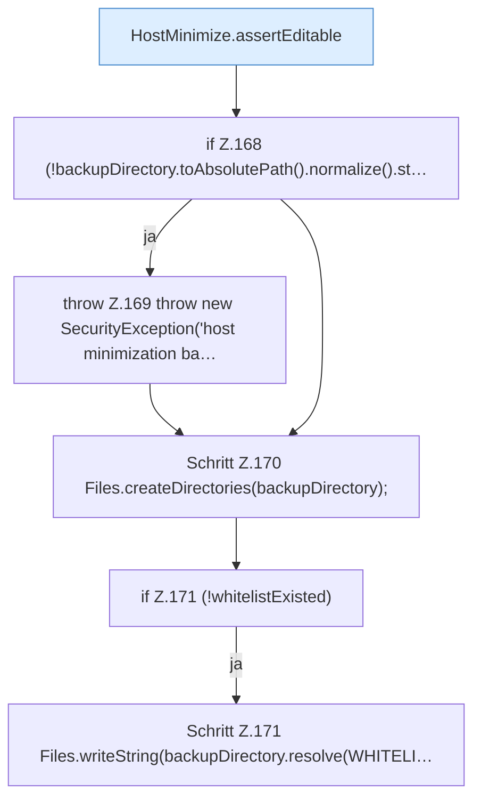

[[00 Start]] › [[Host-Betrieb]] › [[Host-Minimieren]] › [[HostMinimize]] › [[HostMinimize.Teil2]] › [[HostMinimize.apply]] › [[HostMinimize.apply.Teil3]]

# HostMinimize.apply.Teil3



```knoten
HostMinimize.assertEditable
  Das Verkleinern des [[Glossar#Host|Host]] macht hier einen einzelnen Schritt. Eine Ebene tiefer steht er genauer. Prüft `assertEditable`.
if Z.168 (!backupDirectory.toAbsolutePath().normalize().st…
  Zeile 168: prüft `(!backupDirectory.toAbsolutePath().normalize().st…`.
throw Z.169 throw new SecurityException('host minimization ba…
  Zeile 169: Abbruch `throw new SecurityException('host minimization ba…`.
Schritt Z.170 Files.createDirectories(backupDirectory);
  Zeile 170: Dateioperation. `Files.createDirectories(backupDirectory);`
if Z.171 (!whitelistExisted)
  Zeile 171: prüft `(!whitelistExisted)`.
Schritt Z.171 Files.writeString(backupDirectory.resolve(WHITELI…
  Zeile 171: schreibt Text in eine Datei. `Files.writeString(backupDirectory.resolve(WHITELI…`
```

> [!knoten]- Was die Blöcke tun
> - **HostMinimize.assertEditable**: Das Verkleinern des [[Glossar#Host|Host]] macht hier einen einzelnen Schritt. Eine Ebene tiefer steht er genauer. Prüft `assertEditable`.
> - **if Z.168 (!backupDirectory.toAbsolutePath().normalize().st…**: Zeile 168: prüft `(!backupDirectory.toAbsolutePath().normalize().st…`.
> - **throw Z.169 throw new SecurityException('host minimization ba…**: Zeile 169: Abbruch `throw new SecurityException('host minimization ba…`.
> - **Schritt Z.170 Files.createDirectories(backupDirectory);**: Zeile 170: Dateioperation. `Files.createDirectories(backupDirectory);`
> - **if Z.171 (!whitelistExisted)**: Zeile 171: prüft `(!whitelistExisted)`.
> - **Schritt Z.171 Files.writeString(backupDirectory.resolve(WHITELI…**: Zeile 171: schreibt Text in eine Datei. `Files.writeString(backupDirectory.resolve(WHITELI…`

- Ein weiterer Abschnitt derselben Übersicht.
- Fortsetzung von `HostMinimize.apply`.
