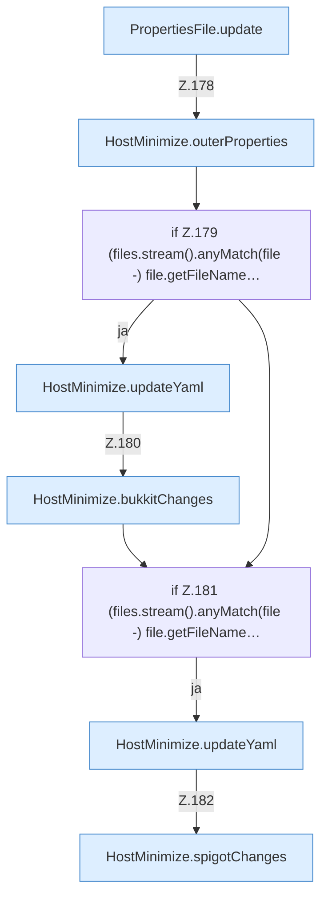

[[00 Start]] › [[Host-Betrieb]] › [[Host-Minimieren]] › [[HostMinimize]] › [[HostMinimize.Teil2]] › [[HostMinimize.apply]] › [[HostMinimize.apply.Teil4.Z177.Teil1]]

# HostMinimize.apply.Teil4.Z177.Teil1



```knoten
PropertiesFile.update
  Aktualisiert `update`.
HostMinimize.outerProperties
  `outerProperties` in `HostMinimize.java`.
if Z.179 (files.stream().anyMatch(file -) file.getFileName…
  Zeile 179: prüft `(files.stream().anyMatch(file -) file.getFileName…`.
HostMinimize.updateYaml
  Aktualisiert `updateYaml`. Ruft `assertNotSymlink`.
HostMinimize.bukkitChanges
  `bukkitChanges` in `HostMinimize.java`.
if Z.181 (files.stream().anyMatch(file -) file.getFileName…
  Zeile 181: prüft `(files.stream().anyMatch(file -) file.getFileName…`.
HostMinimize.spigotChanges
  `spigotChanges` in `HostMinimize.java`.
```

- Fortsetzung von `HostMinimize.apply.Teil4.Z177`, Quellreihenfolge.
