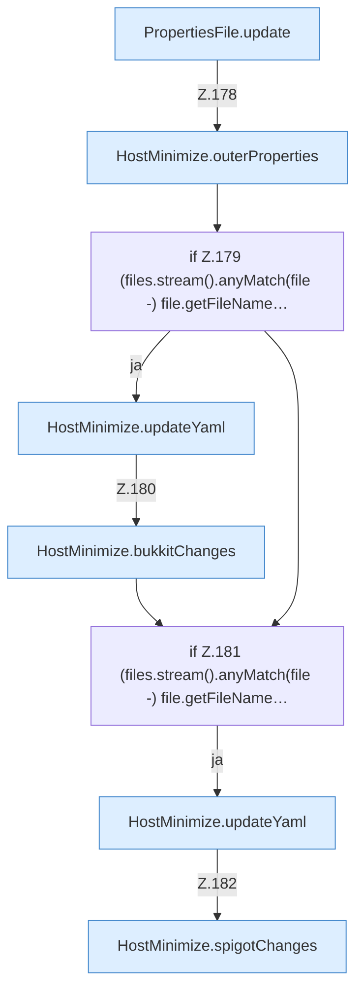

[[00 Start]] › [[Host-Betrieb]] › [[Host-Minimieren]] › [[HostMinimize]] › [[HostMinimize.Teil2]] › [[HostMinimize.apply]] › [[HostMinimize.apply.Teil4.Z177.Teil1]]

# HostMinimize.apply.Teil4.Z177.Teil1



```knoten
PropertiesFile.update
  Dieser Teil ändert das. Aktualisiert `update`.
HostMinimize.outerProperties
  Das Verkleinern des [[Glossar#Host|Host]] kümmert sich um die Eigenschaften. `outerProperties` in `HostMinimize.java`.
if Z.179 (files.stream().anyMatch(file -) file.getFileName…
  Zeile 179: prüft `(files.stream().anyMatch(file -) file.getFileName…`.
HostMinimize.updateYaml
  Das Verkleinern des [[Glossar#Host|Host]] ändert hier einen Schritt. Eine Ebene tiefer steht er genauer. Aktualisiert `updateYaml`. Ruft `assertNotSymlink`.
HostMinimize.bukkitChanges
  Das Verkleinern des [[Glossar#Host|Host]] macht hier einen einzelnen Schritt. Eine Ebene tiefer steht er genauer. `bukkitChanges` in `HostMinimize.java`.
if Z.181 (files.stream().anyMatch(file -) file.getFileName…
  Zeile 181: prüft `(files.stream().anyMatch(file -) file.getFileName…`.
HostMinimize.spigotChanges
  Das Verkleinern des [[Glossar#Host|Host]] macht hier einen einzelnen Schritt. Eine Ebene tiefer steht er genauer. `spigotChanges` in `HostMinimize.java`.
```

> [!knoten]- Was die Blöcke tun
> - **PropertiesFile.update**: Dieser Teil ändert das. Aktualisiert `update`.
> - **HostMinimize.outerProperties**: Das Verkleinern des [[Glossar#Host|Host]] kümmert sich um die Eigenschaften. `outerProperties` in `HostMinimize.java`.
> - **if Z.179 (files.stream().anyMatch(file -) file.getFileName…**: Zeile 179: prüft `(files.stream().anyMatch(file -) file.getFileName…`.
> - **HostMinimize.updateYaml**: Das Verkleinern des [[Glossar#Host|Host]] ändert hier einen Schritt. Eine Ebene tiefer steht er genauer. Aktualisiert `updateYaml`. Ruft `assertNotSymlink`.
> - **HostMinimize.bukkitChanges**: Das Verkleinern des [[Glossar#Host|Host]] macht hier einen einzelnen Schritt. Eine Ebene tiefer steht er genauer. `bukkitChanges` in `HostMinimize.java`.
> - **if Z.181 (files.stream().anyMatch(file -) file.getFileName…**: Zeile 181: prüft `(files.stream().anyMatch(file -) file.getFileName…`.
> - **HostMinimize.spigotChanges**: Das Verkleinern des [[Glossar#Host|Host]] macht hier einen einzelnen Schritt. Eine Ebene tiefer steht er genauer. `spigotChanges` in `HostMinimize.java`.

- Ein weiterer Abschnitt derselben Übersicht.
- Fortsetzung von `HostMinimize.apply.Teil4.Z177`.
