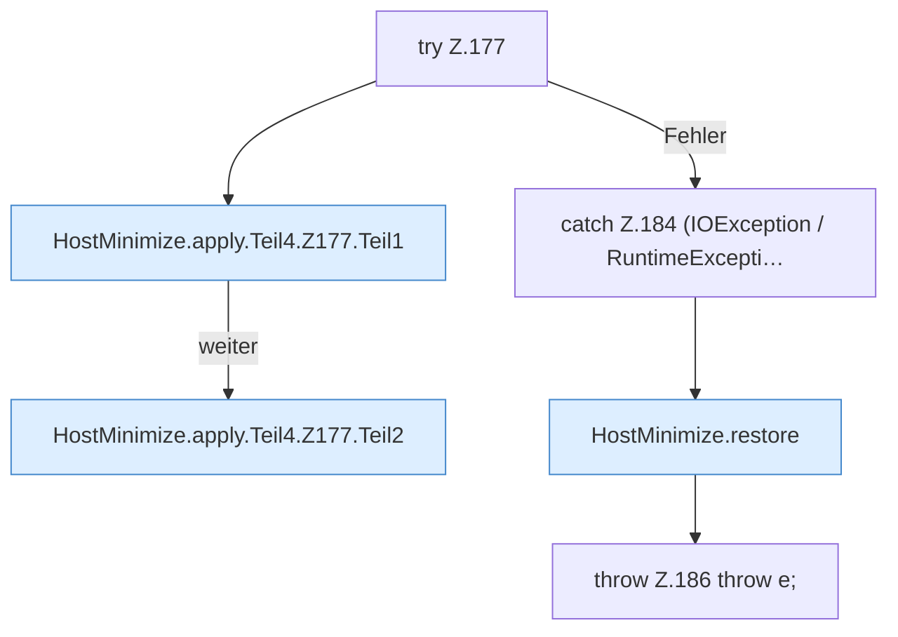

[[00 Start]] › [[Host-Betrieb]] › [[Host-Minimieren]] › [[HostMinimize]] › [[HostMinimize.Teil2]] › [[HostMinimize.apply]] › [[HostMinimize.apply.Teil4.Z177]]

# HostMinimize.apply.Teil4.Z177

- Fortsetzung von `HostMinimize.apply.Teil4`, Quellreihenfolge.
