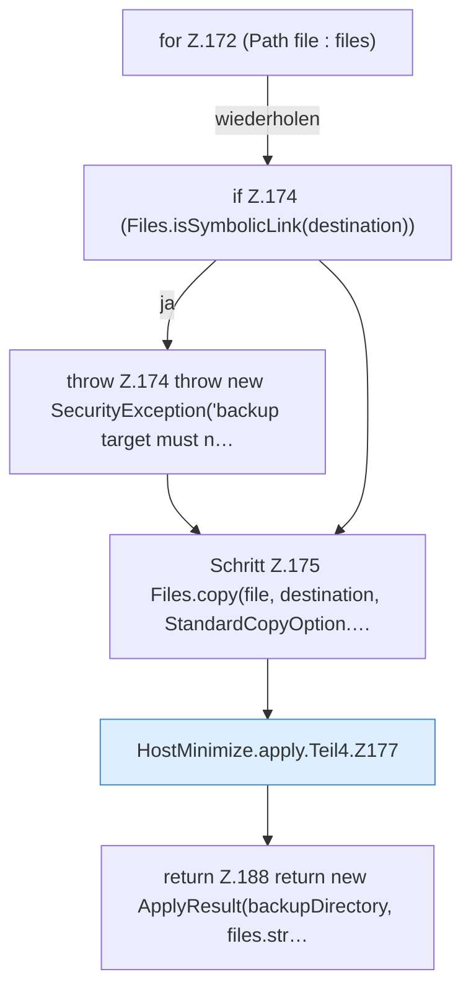

[[00 Start]] › [[Host-Betrieb]] › [[Host-Minimieren]] › [[HostMinimize]] › [[HostMinimize.Teil2]] › [[HostMinimize.apply]] › [[HostMinimize.apply.Teil4]]

# HostMinimize.apply.Teil4



```knoten
for Z.172 (Path file : files)
  Zeile 172: Schleife `(Path file : files)`.
if Z.174 (Files.isSymbolicLink(destination))
  Zeile 174: prüft `(Files.isSymbolicLink(destination))`.
throw Z.174 throw new SecurityException('backup target must n…
  Zeile 174: Abbruch `throw new SecurityException('backup target must n…`.
Schritt Z.175 Files.copy(file, destination, StandardCopyOption.…
  Zeile 175: Dateioperation. `Files.copy(file, destination, StandardCopyOption.…`
HostMinimize.apply.Teil4.Z177
  Fortsetzung des Ablaufs ab Zeile 177.
return Z.188 return new ApplyResult(backupDirectory, files.str…
  Zeile 188: Rückgabe `return new ApplyResult(backupDirectory, files.str…`.
```

- Fortsetzung von `HostMinimize.apply`, Quellreihenfolge.
