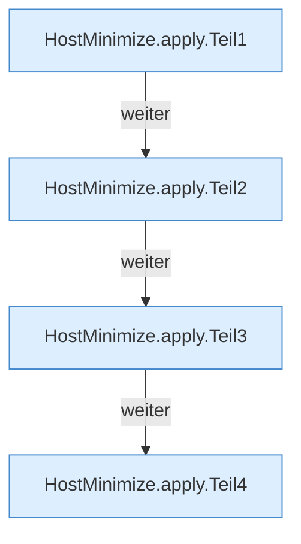

[[00 Start]] › [[Host-Betrieb]] › [[Host-Minimieren]] › [[HostMinimize]] › [[HostMinimize.Teil2]] › [[HostMinimize.apply]]

# HostMinimize.apply

`HostMinimize.apply(Path root, Path backupDirectory, List<Path> protectedPaths)` [src/main/java/de/aichele/childlauncher/HostMinimize.java:151–189](https://github.com/Sciddie/minecraft-serverhoster-plugin/blob/95b02b953b0b4c23673e900e021a7c3c844aa37d/src/main/java/de/aichele/childlauncher/HostMinimize.java#L151-L189)



```knoten
HostMinimize.apply.Teil1
  Ein weiterer Abschnitt derselben Übersicht. Abschnitt 1 dieses Ablaufs, in Quellreihenfolge.
HostMinimize.apply.Teil2
  Ein weiterer Abschnitt derselben Übersicht. Abschnitt 2 dieses Ablaufs, in Quellreihenfolge.
HostMinimize.apply.Teil3
  Ein weiterer Abschnitt derselben Übersicht. Abschnitt 3 dieses Ablaufs, in Quellreihenfolge.
HostMinimize.apply.Teil4
  Ein weiterer Abschnitt derselben Übersicht. Abschnitt 4 dieses Ablaufs, in Quellreihenfolge.
```

> [!knoten]- Was die Blöcke tun
> - **HostMinimize.apply.Teil1**: Ein weiterer Abschnitt derselben Übersicht. Abschnitt 1 dieses Ablaufs, in Quellreihenfolge.
> - **HostMinimize.apply.Teil2**: Ein weiterer Abschnitt derselben Übersicht. Abschnitt 2 dieses Ablaufs, in Quellreihenfolge.
> - **HostMinimize.apply.Teil3**: Ein weiterer Abschnitt derselben Übersicht. Abschnitt 3 dieses Ablaufs, in Quellreihenfolge.
> - **HostMinimize.apply.Teil4**: Ein weiterer Abschnitt derselben Übersicht. Abschnitt 4 dieses Ablaufs, in Quellreihenfolge.

- Das Verkleinern des [[Glossar#Host|Host]] wendet an das.
- `apply` in `src/main/java/de/aichele/childlauncher/HostMinimize.java`
