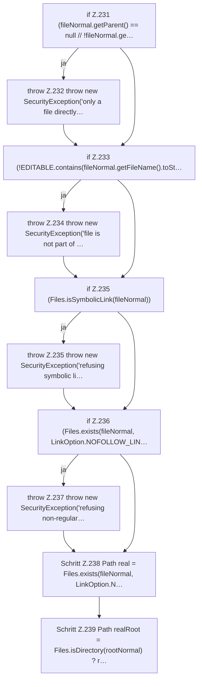

[[00 Start]] › [[Host-Betrieb]] › [[Host-Minimieren]] › [[HostMinimize]] › [[HostMinimize.Teil3]] › [[HostMinimize.assertEditable]] › [[HostMinimize.assertEditable.Teil1]]

# HostMinimize.assertEditable.Teil1



```knoten
if Z.231 (fileNormal.getParent() == null // !fileNormal.ge…
  Zeile 231: prüft `(fileNormal.getParent() == null // !fileNormal.ge…`.
throw Z.232 throw new SecurityException('only a file directly…
  Zeile 232: Abbruch `throw new SecurityException('only a file directly…`.
if Z.233 (!EDITABLE.contains(fileNormal.getFileName().toSt…
  Zeile 233: prüft `(!EDITABLE.contains(fileNormal.getFileName().toSt…`.
throw Z.234 throw new SecurityException('file is not part of …
  Zeile 234: Abbruch `throw new SecurityException('file is not part of …`.
if Z.235 (Files.isSymbolicLink(fileNormal))
  Zeile 235: prüft `(Files.isSymbolicLink(fileNormal))`.
throw Z.235 throw new SecurityException('refusing symbolic li…
  Zeile 235: Abbruch `throw new SecurityException('refusing symbolic li…`.
if Z.236 (Files.exists(fileNormal, LinkOption.NOFOLLOW_LIN…
  Zeile 236: prüft `(Files.exists(fileNormal, LinkOption.NOFOLLOW_LIN…`.
throw Z.237 throw new SecurityException('refusing non-regular…
  Zeile 237: Abbruch `throw new SecurityException('refusing non-regular…`.
Schritt Z.238 Path real = Files.exists(fileNormal, LinkOption.N…
  Zeile 238: Dateioperation. `Path real = Files.exists(fileNormal, LinkOption.N…`
Schritt Z.239 Path realRoot = Files.isDirectory(rootNormal) ? r…
  Zeile 239: Dateioperation. `Path realRoot = Files.isDirectory(rootNormal) ? r…`
```

- Fortsetzung von `HostMinimize.assertEditable`, Quellreihenfolge.
