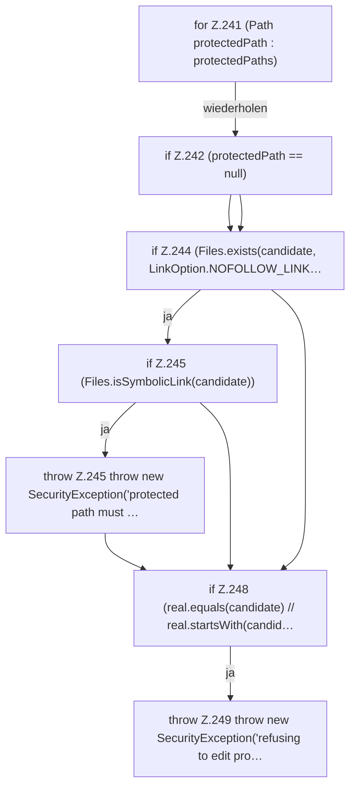

[[00 Start]] › [[Host-Betrieb]] › [[Host-Minimieren]] › [[HostMinimize]] › [[HostMinimize.Teil3]] › [[HostMinimize.assertEditable]] › [[HostMinimize.assertEditable.Teil2.Z241]]

# HostMinimize.assertEditable.Teil2.Z241



```knoten
for Z.241 (Path protectedPath : protectedPaths)
  Zeile 241: Schleife `(Path protectedPath : protectedPaths)`.
if Z.242 (protectedPath == null)
  Zeile 242: prüft `(protectedPath == null)`.
if Z.244 (Files.exists(candidate, LinkOption.NOFOLLOW_LINK…
  Zeile 244: prüft `(Files.exists(candidate, LinkOption.NOFOLLOW_LINK…`.
if Z.245 (Files.isSymbolicLink(candidate))
  Zeile 245: prüft `(Files.isSymbolicLink(candidate))`.
throw Z.245 throw new SecurityException('protected path must …
  Zeile 245: Abbruch `throw new SecurityException('protected path must …`.
if Z.248 (real.equals(candidate) // real.startsWith(candid…
  Zeile 248: prüft `(real.equals(candidate) // real.startsWith(candid…`.
throw Z.249 throw new SecurityException('refusing to edit pro…
  Zeile 249: Abbruch `throw new SecurityException('refusing to edit pro…`.
```

> [!knoten]- Was die Blöcke tun
> - **for Z.241 (Path protectedPath : protectedPaths)**: Zeile 241: Schleife `(Path protectedPath : protectedPaths)`.
> - **if Z.242 (protectedPath == null)**: Zeile 242: prüft `(protectedPath == null)`.
> - **if Z.244 (Files.exists(candidate, LinkOption.NOFOLLOW_LINK…**: Zeile 244: prüft `(Files.exists(candidate, LinkOption.NOFOLLOW_LINK…`.
> - **if Z.245 (Files.isSymbolicLink(candidate))**: Zeile 245: prüft `(Files.isSymbolicLink(candidate))`.
> - **throw Z.245 throw new SecurityException('protected path must …**: Zeile 245: Abbruch `throw new SecurityException('protected path must …`.
> - **if Z.248 (real.equals(candidate) // real.startsWith(candid…**: Zeile 248: prüft `(real.equals(candidate) // real.startsWith(candid…`.
> - **throw Z.249 throw new SecurityException('refusing to edit pro…**: Zeile 249: Abbruch `throw new SecurityException('refusing to edit pro…`.

- Der Ablauf geht in [[Glossar#Zeile|Zeile]] 241 weiter. Eine Ebene tiefer steht er genauer.
- Fortsetzung von `HostMinimize.assertEditable.Teil2`.
