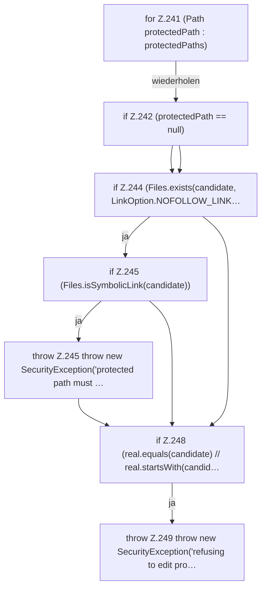

[[00 Start]] › [[Host-Betrieb]] › [[Host-Minimieren]] › [[HostMinimize]] › [[HostMinimize.Teil3]] › [[HostMinimize.assertEditable]] › [[HostMinimize.assertEditable.Teil2.Z241]]

# HostMinimize.assertEditable.Teil2.Z241

- Fortsetzung von `HostMinimize.assertEditable.Teil2`, Quellreihenfolge.
