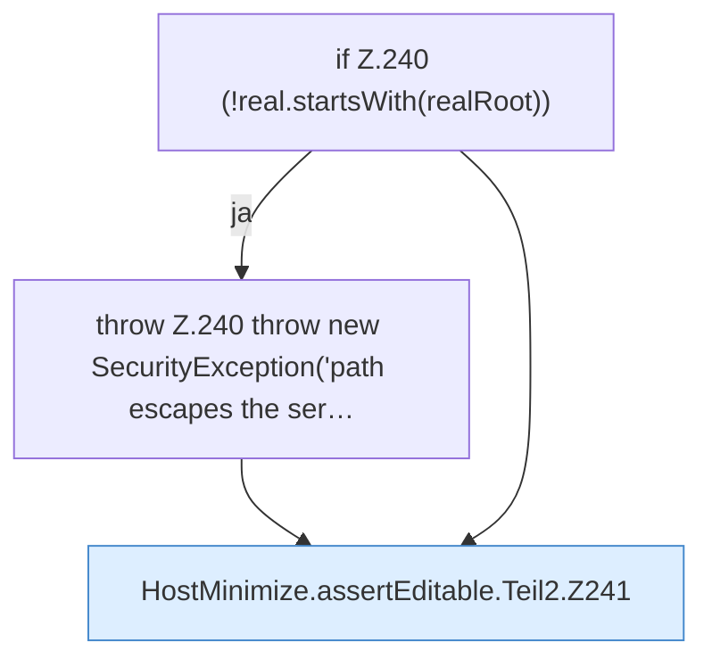

[[00 Start]] › [[Host-Betrieb]] › [[Host-Minimieren]] › [[HostMinimize]] › [[HostMinimize.Teil3]] › [[HostMinimize.assertEditable]] › [[HostMinimize.assertEditable.Teil2]]

# HostMinimize.assertEditable.Teil2



```knoten
if Z.240 (!real.startsWith(realRoot))
  Zeile 240: prüft `(!real.startsWith(realRoot))`.
throw Z.240 throw new SecurityException('path escapes the ser…
  Zeile 240: Abbruch `throw new SecurityException('path escapes the ser…`.
HostMinimize.assertEditable.Teil2.Z241
  Fortsetzung des Ablaufs ab Zeile 241.
```

- Fortsetzung von `HostMinimize.assertEditable`, Quellreihenfolge.
