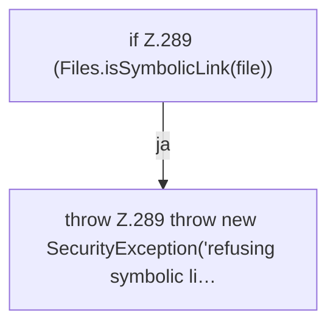

[[00 Start]] › [[Host-Betrieb]] › [[Host-Minimieren]] › [[HostMinimize]] › [[HostMinimize.Teil3]] › [[HostMinimize.assertNotSymlink]]

# HostMinimize.assertNotSymlink

`HostMinimize.assertNotSymlink(Path file)` [src/main/java/de/aichele/childlauncher/HostMinimize.java:288–290](https://github.com/Sciddie/minecraft-serverhoster-plugin/blob/95b02b953b0b4c23673e900e021a7c3c844aa37d/src/main/java/de/aichele/childlauncher/HostMinimize.java#L288-L290)



```knoten
if Z.289 (Files.isSymbolicLink(file))
  Zeile 289: prüft `(Files.isSymbolicLink(file))`.
throw Z.289 throw new SecurityException('refusing symbolic li…
  Zeile 289: Abbruch `throw new SecurityException('refusing symbolic li…`.
```

- `assertNotSymlink` in `src/main/java/de/aichele/childlauncher/HostMinimize.java`
