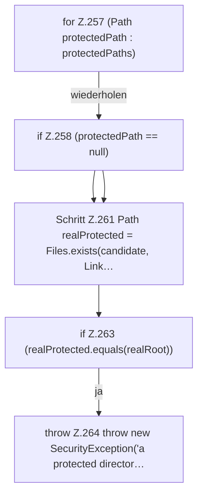

[[00 Start]] › [[Host-Betrieb]] › [[Host-Minimieren]] › [[HostMinimize]] › [[HostMinimize.Teil3]] › [[HostMinimize.assertRoot]] › [[HostMinimize.assertRoot.Z257]]

# HostMinimize.assertRoot.Z257



```knoten
for Z.257 (Path protectedPath : protectedPaths)
  Zeile 257: Schleife `(Path protectedPath : protectedPaths)`.
if Z.258 (protectedPath == null)
  Zeile 258: prüft `(protectedPath == null)`.
Schritt Z.261 Path realProtected = Files.exists(candidate, Link…
  Zeile 261: Dateioperation. `Path realProtected = Files.exists(candidate, Link…`
if Z.263 (realProtected.equals(realRoot))
  Zeile 263: prüft `(realProtected.equals(realRoot))`.
throw Z.264 throw new SecurityException('a protected director…
  Zeile 264: Abbruch `throw new SecurityException('a protected director…`.
```

> [!knoten]- Was die Blöcke tun
> - **for Z.257 (Path protectedPath : protectedPaths)**: Zeile 257: Schleife `(Path protectedPath : protectedPaths)`.
> - **if Z.258 (protectedPath == null)**: Zeile 258: prüft `(protectedPath == null)`.
> - **Schritt Z.261 Path realProtected = Files.exists(candidate, Link…**: Zeile 261: Dateioperation. `Path realProtected = Files.exists(candidate, Link…`
> - **if Z.263 (realProtected.equals(realRoot))**: Zeile 263: prüft `(realProtected.equals(realRoot))`.
> - **throw Z.264 throw new SecurityException('a protected director…**: Zeile 264: Abbruch `throw new SecurityException('a protected director…`.

- Der Ablauf geht in [[Glossar#Zeile|Zeile]] 257 weiter. Eine Ebene tiefer steht er genauer.
- Fortsetzung von `HostMinimize.assertRoot`.
