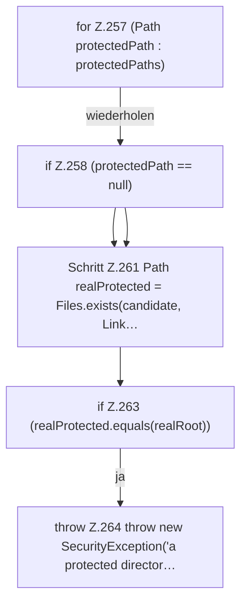

[[00 Start]] › [[Host-Betrieb]] › [[Host-Minimieren]] › [[HostMinimize]] › [[HostMinimize.Teil3]] › [[HostMinimize.assertRoot]] › [[HostMinimize.assertRoot.Z257]]

# HostMinimize.assertRoot.Z257

- Fortsetzung von `HostMinimize.assertRoot`, Quellreihenfolge.
