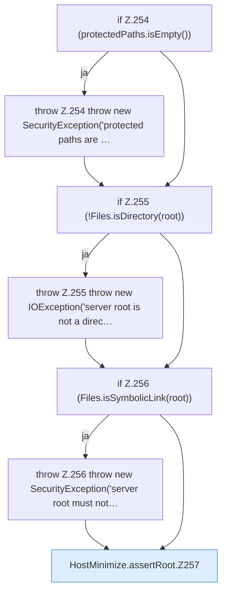

[[00 Start]] › [[Host-Betrieb]] › [[Host-Minimieren]] › [[HostMinimize]] › [[HostMinimize.Teil3]] › [[HostMinimize.assertRoot]]

# HostMinimize.assertRoot

`HostMinimize.assertRoot(Path root, List<Path> protectedPaths)` [src/main/java/de/aichele/childlauncher/HostMinimize.java:253–266](https://github.com/Sciddie/minecraft-serverhoster-plugin/blob/95b02b953b0b4c23673e900e021a7c3c844aa37d/src/main/java/de/aichele/childlauncher/HostMinimize.java#L253-L266)



```knoten
if Z.254 (protectedPaths.isEmpty())
  Zeile 254: prüft `(protectedPaths.isEmpty())`.
throw Z.254 throw new SecurityException('protected paths are …
  Zeile 254: Abbruch `throw new SecurityException('protected paths are …`.
if Z.255 (!Files.isDirectory(root))
  Zeile 255: prüft `(!Files.isDirectory(root))`.
throw Z.255 throw new IOException('server root is not a direc…
  Zeile 255: Abbruch `throw new IOException('server root is not a direc…`.
if Z.256 (Files.isSymbolicLink(root))
  Zeile 256: prüft `(Files.isSymbolicLink(root))`.
throw Z.256 throw new SecurityException('server root must not…
  Zeile 256: Abbruch `throw new SecurityException('server root must not…`.
HostMinimize.assertRoot.Z257
  Der Ablauf geht in [[Glossar#Zeile|Zeile]] 257 weiter. Eine Ebene tiefer steht er genauer. Fortsetzung des Ablaufs ab Zeile 257.
```

> [!knoten]- Was die Blöcke tun
> - **if Z.254 (protectedPaths.isEmpty())**: Zeile 254: prüft `(protectedPaths.isEmpty())`.
> - **throw Z.254 throw new SecurityException('protected paths are …**: Zeile 254: Abbruch `throw new SecurityException('protected paths are …`.
> - **if Z.255 (!Files.isDirectory(root))**: Zeile 255: prüft `(!Files.isDirectory(root))`.
> - **throw Z.255 throw new IOException('server root is not a direc…**: Zeile 255: Abbruch `throw new IOException('server root is not a direc…`.
> - **if Z.256 (Files.isSymbolicLink(root))**: Zeile 256: prüft `(Files.isSymbolicLink(root))`.
> - **throw Z.256 throw new SecurityException('server root must not…**: Zeile 256: Abbruch `throw new SecurityException('server root must not…`.
> - **HostMinimize.assertRoot.Z257**: Der Ablauf geht in [[Glossar#Zeile|Zeile]] 257 weiter. Eine Ebene tiefer steht er genauer. Fortsetzung des Ablaufs ab Zeile 257.

- Das Verkleinern des [[Glossar#Host|Host]] kümmert sich um den Anfang.
- `assertRoot` in `src/main/java/de/aichele/childlauncher/HostMinimize.java`
