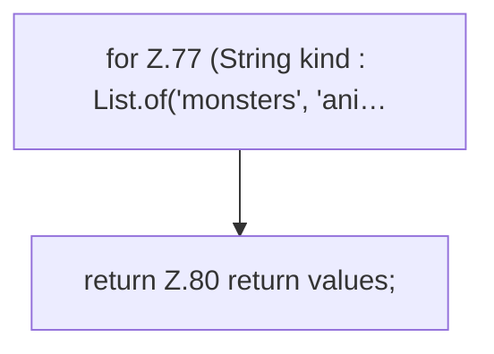

[[00 Start]] › [[Host-Betrieb]] › [[Host-Minimieren]] › [[HostMinimize]] › [[HostMinimize.Teil1]] › [[HostMinimize.bukkitChanges]]

# HostMinimize.bukkitChanges

`HostMinimize.bukkitChanges()` [src/main/java/de/aichele/childlauncher/HostMinimize.java:73–81](https://github.com/Sciddie/minecraft-serverhoster-plugin/blob/95b02b953b0b4c23673e900e021a7c3c844aa37d/src/main/java/de/aichele/childlauncher/HostMinimize.java#L73-L81)



```knoten
for Z.77 (String kind : List.of('monsters', 'ani…
  Zeile 77: Schleife `(String kind : List.of('monsters', 'ani…`.
return Z.80 return values;
  Zeile 80: Rückgabe `return values;`.
```

> [!knoten]- Was die Blöcke tun
> - **for Z.77 (String kind : List.of('monsters', 'ani…**: Zeile 77: Schleife `(String kind : List.of('monsters', 'ani…`.
> - **return Z.80 return values;**: Zeile 80: Rückgabe `return values;`.

- Das Verkleinern des [[Glossar#Host|Host]] macht hier einen einzelnen Schritt. Eine Ebene tiefer steht er genauer.
- `bukkitChanges` in `src/main/java/de/aichele/childlauncher/HostMinimize.java`
