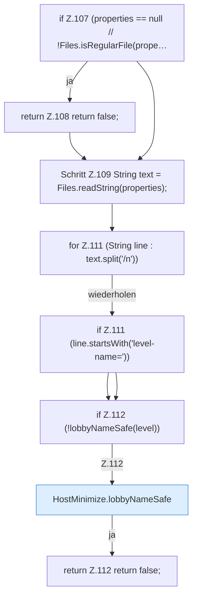

[[00 Start]] › [[Host-Betrieb]] › [[Host-Minimieren]] › [[HostMinimize]] › [[HostMinimize.Teil2]] › [[HostMinimize.clearIdlePause]] › [[HostMinimize.clearIdlePause.Teil1]]

# HostMinimize.clearIdlePause.Teil1



```knoten
if Z.107 (properties == null // !Files.isRegularFile(prope…
  Zeile 107: prüft `(properties == null // !Files.isRegularFile(prope…`.
return Z.108 return false;
  Zeile 108: Rückgabe `return false;`.
Schritt Z.109 String text = Files.readString(properties);
  Zeile 109: liest Text aus einer Datei. `String text = Files.readString(properties);`
for Z.111 (String line : text.split('/n'))
  Zeile 111: Schleife `(String line : text.split('/n'))`.
if Z.111 (line.startsWith('level-name='))
  Zeile 111: prüft `(line.startsWith('level-name='))`.
if Z.112 (!lobbyNameSafe(level))
  Zeile 112: prüft `(!lobbyNameSafe(level))`.
HostMinimize.lobbyNameSafe
  Das Verkleinern des [[Glossar#Host|Host]] kümmert sich um den Namen die erlaubte Grenze. `lobbyNameSafe` in `HostMinimize.java`.
return Z.112 return false;
  Zeile 112: Rückgabe `return false;`.
```

> [!knoten]- Was die Blöcke tun
> - **if Z.107 (properties == null // !Files.isRegularFile(prope…**: Zeile 107: prüft `(properties == null // !Files.isRegularFile(prope…`.
> - **return Z.108 return false;**: Zeile 108: Rückgabe `return false;`.
> - **Schritt Z.109 String text = Files.readString(properties);**: Zeile 109: liest Text aus einer Datei. `String text = Files.readString(properties);`
> - **for Z.111 (String line : text.split('/n'))**: Zeile 111: Schleife `(String line : text.split('/n'))`.
> - **if Z.111 (line.startsWith('level-name='))**: Zeile 111: prüft `(line.startsWith('level-name='))`.
> - **if Z.112 (!lobbyNameSafe(level))**: Zeile 112: prüft `(!lobbyNameSafe(level))`.
> - **HostMinimize.lobbyNameSafe**: Das Verkleinern des [[Glossar#Host|Host]] kümmert sich um den Namen die erlaubte Grenze. `lobbyNameSafe` in `HostMinimize.java`.
> - **return Z.112 return false;**: Zeile 112: Rückgabe `return false;`.

- Ein weiterer Abschnitt derselben Übersicht.
- Fortsetzung von `HostMinimize.clearIdlePause`.
