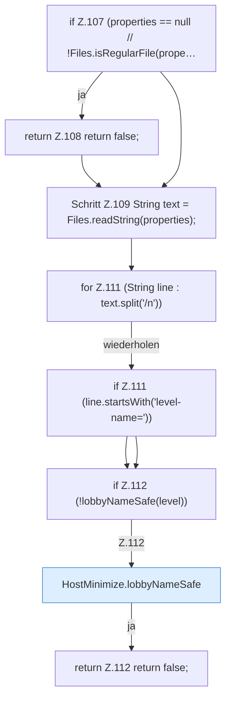

[[00 Start]] › [[Host-Betrieb]] › [[Host-Minimieren]] › [[HostMinimize]] › [[HostMinimize.Teil2]] › [[HostMinimize.clearIdlePause]] › [[HostMinimize.clearIdlePause.Teil1]]

# HostMinimize.clearIdlePause.Teil1

- Fortsetzung von `HostMinimize.clearIdlePause`, Quellreihenfolge.
