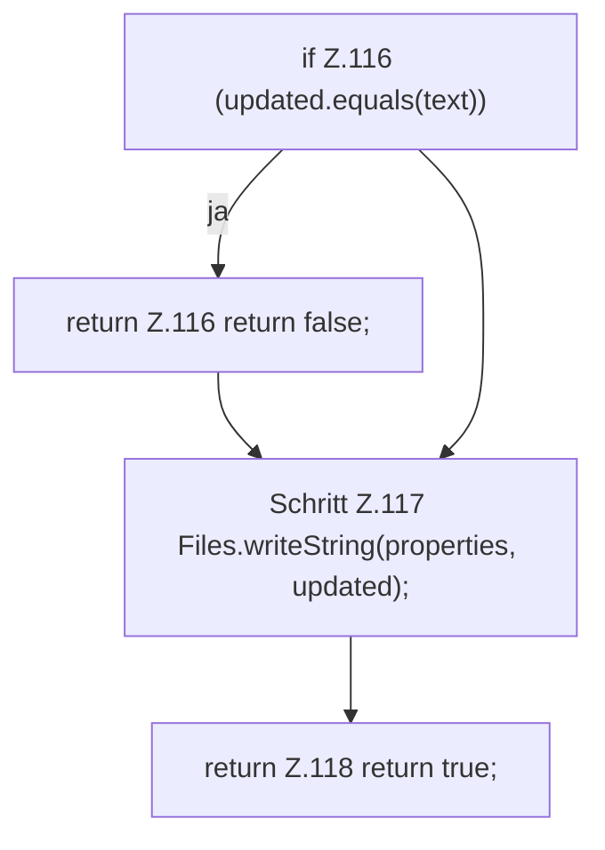

[[00 Start]] › [[Host-Betrieb]] › [[Host-Minimieren]] › [[HostMinimize]] › [[HostMinimize.Teil2]] › [[HostMinimize.clearIdlePause]] › [[HostMinimize.clearIdlePause.Teil2]]

# HostMinimize.clearIdlePause.Teil2



```knoten
if Z.116 (updated.equals(text))
  Zeile 116: prüft `(updated.equals(text))`.
return Z.116 return false;
  Zeile 116: Rückgabe `return false;`.
Schritt Z.117 Files.writeString(properties, updated);
  Zeile 117: schreibt Text in eine Datei. `Files.writeString(properties, updated);`
return Z.118 return true;
  Zeile 118: Rückgabe `return true;`.
```

> [!knoten]- Was die Blöcke tun
> - **if Z.116 (updated.equals(text))**: Zeile 116: prüft `(updated.equals(text))`.
> - **return Z.116 return false;**: Zeile 116: Rückgabe `return false;`.
> - **Schritt Z.117 Files.writeString(properties, updated);**: Zeile 117: schreibt Text in eine Datei. `Files.writeString(properties, updated);`
> - **return Z.118 return true;**: Zeile 118: Rückgabe `return true;`.

- Ein weiterer Abschnitt derselben Übersicht.
- Fortsetzung von `HostMinimize.clearIdlePause`.
