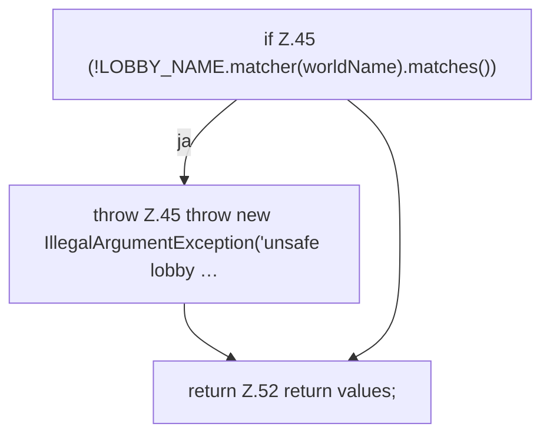

[[00 Start]] › [[Host-Betrieb]] › [[Host-Minimieren]] › [[HostMinimize]] › [[HostMinimize.Teil1]] › [[HostMinimize.firstSetupProperties]]

# HostMinimize.firstSetupProperties

`HostMinimize.firstSetupProperties(String worldName)` [src/main/java/de/aichele/childlauncher/HostMinimize.java:44–53](https://github.com/Sciddie/minecraft-serverhoster-plugin/blob/95b02b953b0b4c23673e900e021a7c3c844aa37d/src/main/java/de/aichele/childlauncher/HostMinimize.java#L44-L53)



```knoten
if Z.45 (!LOBBY_NAME.matcher(worldName).matches())
  Zeile 45: prüft `(!LOBBY_NAME.matcher(worldName).matches())`.
throw Z.45 throw new IllegalArgumentException('unsafe lobby …
  Zeile 45: Abbruch `throw new IllegalArgumentException('unsafe lobby …`.
return Z.52 return values;
  Zeile 52: Rückgabe `return values;`.
```

- `firstSetupProperties` in `src/main/java/de/aichele/childlauncher/HostMinimize.java`
