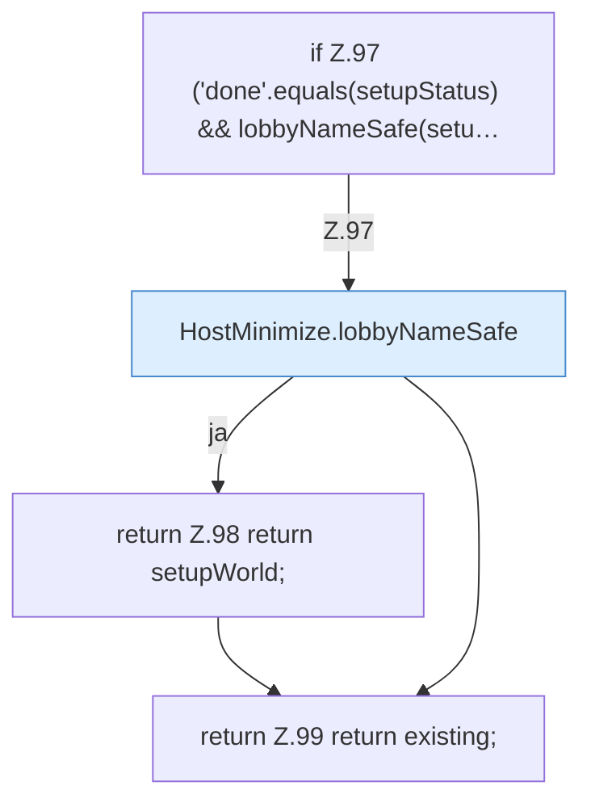

[[00 Start]] › [[Host-Betrieb]] › [[Host-Minimieren]] › [[HostMinimize]] › [[HostMinimize.Teil2]] › [[HostMinimize.firstSetupWorld]]

# HostMinimize.firstSetupWorld

`HostMinimize.firstSetupWorld(String existing, String level, String setupStatus, String setupWorld, boolean loaded)` [src/main/java/de/aichele/childlauncher/HostMinimize.java:96–100](https://github.com/Sciddie/minecraft-serverhoster-plugin/blob/95b02b953b0b4c23673e900e021a7c3c844aa37d/src/main/java/de/aichele/childlauncher/HostMinimize.java#L96-L100)

- `firstSetupWorld` in `src/main/java/de/aichele/childlauncher/HostMinimize.java`
