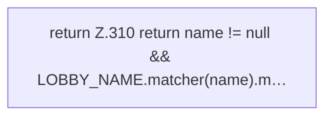

[[00 Start]] › [[Host-Betrieb]] › [[Host-Minimieren]] › [[HostMinimize]] › [[HostMinimize.Teil3]] › [[HostMinimize.lobbyNameSafe]]

# HostMinimize.lobbyNameSafe

`HostMinimize.lobbyNameSafe(String name)` [src/main/java/de/aichele/childlauncher/HostMinimize.java:309–311](https://github.com/Sciddie/minecraft-serverhoster-plugin/blob/95b02b953b0b4c23673e900e021a7c3c844aa37d/src/main/java/de/aichele/childlauncher/HostMinimize.java#L309-L311)



```knoten
return Z.310 return name != null && LOBBY_NAME.matcher(name).m…
  Zeile 310: Rückgabe `return name != null && LOBBY_NAME.matcher(name).m…`.
```

- `lobbyNameSafe` in `src/main/java/de/aichele/childlauncher/HostMinimize.java`
