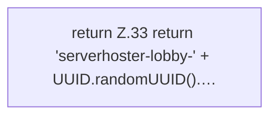

[[00 Start]] › [[Host-Betrieb]] › [[Host-Minimieren]] › [[HostMinimize]] › [[HostMinimize.Teil1]] › [[HostMinimize.newLobbyName()]]

# HostMinimize.newLobbyName()

`HostMinimize.newLobbyName()` [src/main/java/de/aichele/childlauncher/HostMinimize.java:32–34](https://github.com/Sciddie/minecraft-serverhoster-plugin/blob/95b02b953b0b4c23673e900e021a7c3c844aa37d/src/main/java/de/aichele/childlauncher/HostMinimize.java#L32-L34)



```knoten
return Z.33 return 'serverhoster-lobby-' + UUID.randomUUID().…
  Zeile 33: Rückgabe `return 'serverhoster-lobby-' + UUID.randomUUID().…`.
```

> [!knoten]- Was die Blöcke tun
> - **return Z.33 return 'serverhoster-lobby-' + UUID.randomUUID().…**: Zeile 33: Rückgabe `return 'serverhoster-lobby-' + UUID.randomUUID().…`.

- Das Verkleinern des [[Glossar#Host|Host]] kümmert sich um die Wartewelt den Namen.
- `newLobbyName` in `src/main/java/de/aichele/childlauncher/HostMinimize.java`
