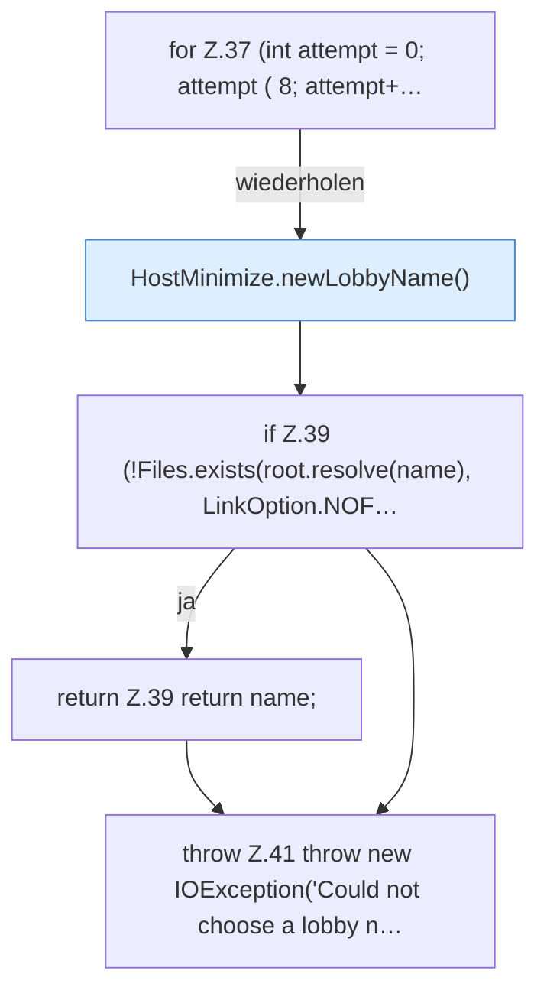

[[00 Start]] › [[Host-Betrieb]] › [[Host-Minimieren]] › [[HostMinimize]] › [[HostMinimize.Teil1]] › [[HostMinimize.newLobbyName(Path)]]

# HostMinimize.newLobbyName(Path)

`HostMinimize.newLobbyName(Path root)` [src/main/java/de/aichele/childlauncher/HostMinimize.java:36–42](https://github.com/Sciddie/minecraft-serverhoster-plugin/blob/95b02b953b0b4c23673e900e021a7c3c844aa37d/src/main/java/de/aichele/childlauncher/HostMinimize.java#L36-L42)



```knoten
for Z.37 (int attempt = 0; attempt ( 8; attempt+…
  Zeile 37: Schleife `(int attempt = 0; attempt ( 8; attempt+…`.
HostMinimize.newLobbyName()
  Das Verkleinern des [[Glossar#Host|Host]] kümmert sich um die Wartewelt den Namen. `newLobbyName` in `HostMinimize.java`.
if Z.39 (!Files.exists(root.resolve(name), LinkOption.NOF…
  Zeile 39: prüft `(!Files.exists(root.resolve(name), LinkOption.NOF…`.
return Z.39 return name;
  Zeile 39: Rückgabe `return name;`.
throw Z.41 throw new IOException('Could not choose a lobby n…
  Zeile 41: Abbruch `throw new IOException('Could not choose a lobby n…`.
```

> [!knoten]- Was die Blöcke tun
> - **for Z.37 (int attempt = 0; attempt ( 8; attempt+…**: Zeile 37: Schleife `(int attempt = 0; attempt ( 8; attempt+…`.
> - **HostMinimize.newLobbyName()**: Das Verkleinern des [[Glossar#Host|Host]] kümmert sich um die Wartewelt den Namen. `newLobbyName` in `HostMinimize.java`.
> - **if Z.39 (!Files.exists(root.resolve(name), LinkOption.NOF…**: Zeile 39: prüft `(!Files.exists(root.resolve(name), LinkOption.NOF…`.
> - **return Z.39 return name;**: Zeile 39: Rückgabe `return name;`.
> - **throw Z.41 throw new IOException('Could not choose a lobby n…**: Zeile 41: Abbruch `throw new IOException('Could not choose a lobby n…`.

- Das Verkleinern des [[Glossar#Host|Host]] kümmert sich um die Wartewelt den Namen.
- `newLobbyName` in `src/main/java/de/aichele/childlauncher/HostMinimize.java`
