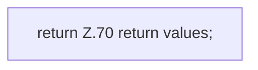

[[00 Start]] › [[Host-Betrieb]] › [[Host-Minimieren]] › [[HostMinimize]] › [[HostMinimize.Teil1]] › [[HostMinimize.outerProperties]] › [[HostMinimize.outerProperties.Teil2]]

# HostMinimize.outerProperties.Teil2



```knoten
return Z.70 return values;
  Zeile 70: Rückgabe `return values;`.
```

- Fortsetzung von `HostMinimize.outerProperties`, Quellreihenfolge.
