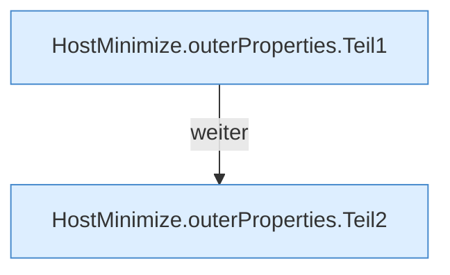

[[00 Start]] › [[Host-Betrieb]] › [[Host-Minimieren]] › [[HostMinimize]] › [[HostMinimize.Teil1]] › [[HostMinimize.outerProperties]]

# HostMinimize.outerProperties

`HostMinimize.outerProperties()` [src/main/java/de/aichele/childlauncher/HostMinimize.java:55–71](https://github.com/Sciddie/minecraft-serverhoster-plugin/blob/95b02b953b0b4c23673e900e021a7c3c844aa37d/src/main/java/de/aichele/childlauncher/HostMinimize.java#L55-L71)



```knoten
HostMinimize.outerProperties.Teil1
  Abschnitt 1 dieses Ablaufs, in Quellreihenfolge.
HostMinimize.outerProperties.Teil2
  Abschnitt 2 dieses Ablaufs, in Quellreihenfolge.
```

- `outerProperties` in `src/main/java/de/aichele/childlauncher/HostMinimize.java`
