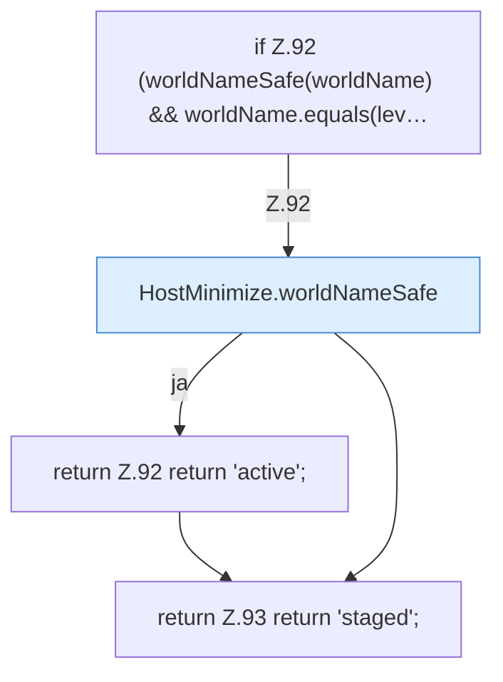

[[00 Start]] › [[Host-Betrieb]] › [[Host-Minimieren]] › [[HostMinimize]] › [[HostMinimize.Teil1]] › [[HostMinimize.phase]]

# HostMinimize.phase

`HostMinimize.phase(String worldName, String levelName, boolean worldLoaded)` [src/main/java/de/aichele/childlauncher/HostMinimize.java:91–94](https://github.com/Sciddie/minecraft-serverhoster-plugin/blob/95b02b953b0b4c23673e900e021a7c3c844aa37d/src/main/java/de/aichele/childlauncher/HostMinimize.java#L91-L94)



```knoten
if Z.92 (worldNameSafe(worldName) && worldName.equals(lev…
  Zeile 92: prüft `(worldNameSafe(worldName) && worldName.equals(lev…`.
HostMinimize.worldNameSafe
  Betrifft die Welt `worldNameSafe`.
return Z.92 return 'active';
  Zeile 92: Rückgabe `return 'active';`.
return Z.93 return 'staged';
  Zeile 93: Rückgabe `return 'staged';`.
```

- `phase` in `src/main/java/de/aichele/childlauncher/HostMinimize.java`
