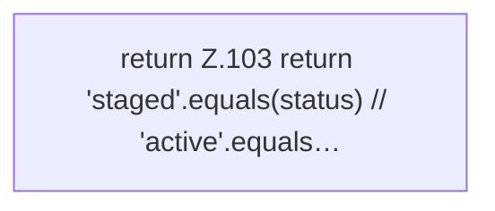

[[00 Start]] › [[Host-Betrieb]] › [[Host-Minimieren]] › [[HostMinimize]] › [[HostMinimize.Teil2]] › [[HostMinimize.playersBlocked]]

# HostMinimize.playersBlocked

`HostMinimize.playersBlocked(String status)` [src/main/java/de/aichele/childlauncher/HostMinimize.java:102–104](https://github.com/Sciddie/minecraft-serverhoster-plugin/blob/95b02b953b0b4c23673e900e021a7c3c844aa37d/src/main/java/de/aichele/childlauncher/HostMinimize.java#L102-L104)

- `playersBlocked` in `src/main/java/de/aichele/childlauncher/HostMinimize.java`
- Befund: toter Code, wahrscheinlich. src/main/java/de/aichele/childlauncher/HostMinimize.java:102–104 nur von Tests erreicht
