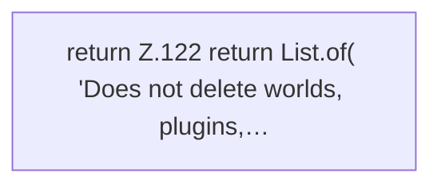

[[00 Start]] › [[Host-Betrieb]] › [[Host-Minimieren]] › [[HostMinimize]] › [[HostMinimize.Teil2]] › [[HostMinimize.preservedNotes]]

# HostMinimize.preservedNotes

`HostMinimize.preservedNotes()` [src/main/java/de/aichele/childlauncher/HostMinimize.java:121–129](https://github.com/Sciddie/minecraft-serverhoster-plugin/blob/95b02b953b0b4c23673e900e021a7c3c844aa37d/src/main/java/de/aichele/childlauncher/HostMinimize.java#L121-L129)



```knoten
return Z.122 return List.of( 'Does not delete worlds, plugins,…
  Zeile 122: Rückgabe `return List.of( 'Does not delete worlds, plugins,…`.
```

> [!knoten]- Was die Blöcke tun
> - **return Z.122 return List.of( 'Does not delete worlds, plugins,…**: Zeile 122: Rückgabe `return List.of( 'Does not delete worlds, plugins,…`.

- Das Verkleinern des [[Glossar#Host|Host]] macht hier einen einzelnen Schritt. Eine Ebene tiefer steht er genauer.
- `preservedNotes` in `src/main/java/de/aichele/childlauncher/HostMinimize.java`
