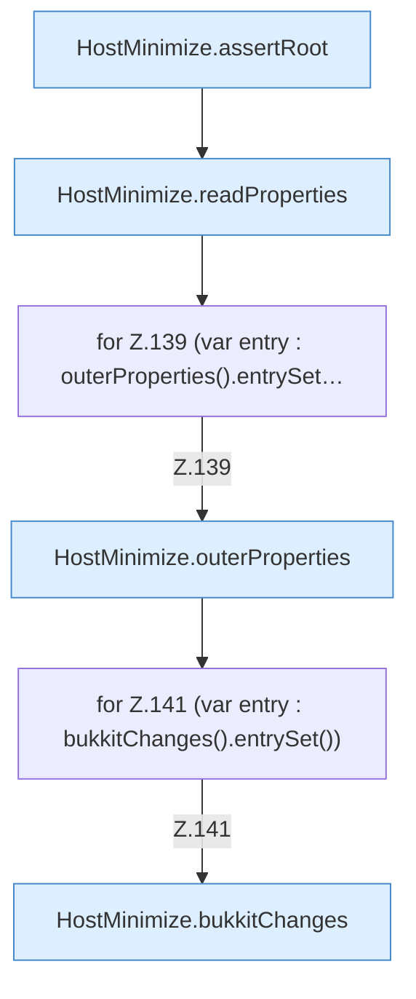

[[00 Start]] › [[Host-Betrieb]] › [[Host-Minimieren]] › [[HostMinimize]] › [[HostMinimize.Teil2]] › [[HostMinimize.preview]] › [[HostMinimize.preview.Teil1]]

# HostMinimize.preview.Teil1



```knoten
HostMinimize.assertRoot
  Das Verkleinern des [[Glossar#Host|Host]] kümmert sich um den Anfang. Prüft `assertRoot`.
HostMinimize.readProperties
  Das Verkleinern des [[Glossar#Host|Host]] liest die Eigenschaften. Liest `readProperties`.
for Z.139 (var entry : outerProperties().entrySet…
  Zeile 139: Schleife `(var entry : outerProperties().entrySet…`.
HostMinimize.outerProperties
  Das Verkleinern des [[Glossar#Host|Host]] kümmert sich um die Eigenschaften. `outerProperties` in `HostMinimize.java`.
for Z.141 (var entry : bukkitChanges().entrySet())
  Zeile 141: Schleife `(var entry : bukkitChanges().entrySet())`.
HostMinimize.bukkitChanges
  Das Verkleinern des [[Glossar#Host|Host]] macht hier einen einzelnen Schritt. Eine Ebene tiefer steht er genauer. `bukkitChanges` in `HostMinimize.java`.
```

> [!knoten]- Was die Blöcke tun
> - **HostMinimize.assertRoot**: Das Verkleinern des [[Glossar#Host|Host]] kümmert sich um den Anfang. Prüft `assertRoot`.
> - **HostMinimize.readProperties**: Das Verkleinern des [[Glossar#Host|Host]] liest die Eigenschaften. Liest `readProperties`.
> - **for Z.139 (var entry : outerProperties().entrySet…**: Zeile 139: Schleife `(var entry : outerProperties().entrySet…`.
> - **HostMinimize.outerProperties**: Das Verkleinern des [[Glossar#Host|Host]] kümmert sich um die Eigenschaften. `outerProperties` in `HostMinimize.java`.
> - **for Z.141 (var entry : bukkitChanges().entrySet())**: Zeile 141: Schleife `(var entry : bukkitChanges().entrySet())`.
> - **HostMinimize.bukkitChanges**: Das Verkleinern des [[Glossar#Host|Host]] macht hier einen einzelnen Schritt. Eine Ebene tiefer steht er genauer. `bukkitChanges` in `HostMinimize.java`.

- Ein weiterer Abschnitt derselben Übersicht.
- Fortsetzung von `HostMinimize.preview`.
