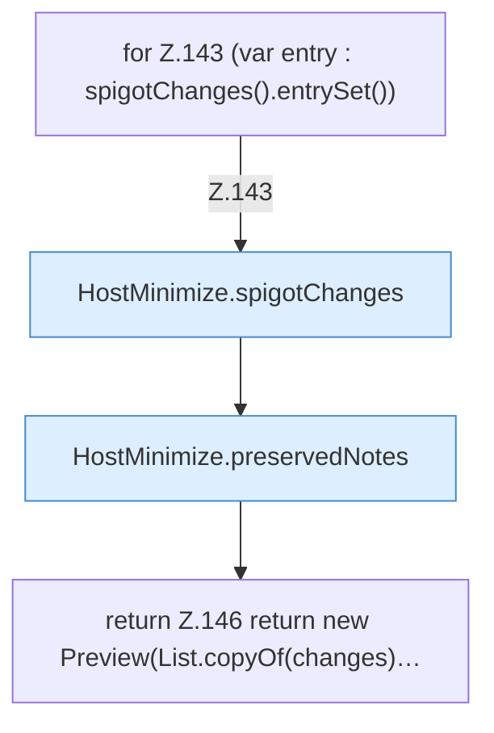

[[00 Start]] › [[Host-Betrieb]] › [[Host-Minimieren]] › [[HostMinimize]] › [[HostMinimize.Teil2]] › [[HostMinimize.preview]] › [[HostMinimize.preview.Teil2]]

# HostMinimize.preview.Teil2

- Fortsetzung von `HostMinimize.preview`, Quellreihenfolge.
