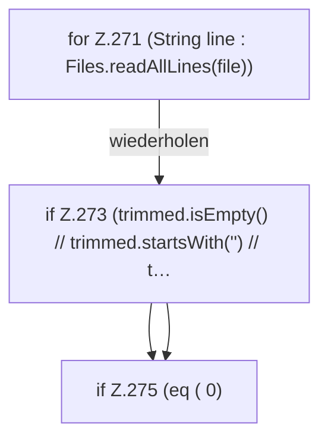

[[00 Start]] › [[Host-Betrieb]] › [[Host-Minimieren]] › [[HostMinimize]] › [[HostMinimize.Teil3]] › [[HostMinimize.readProperties]] › [[HostMinimize.readProperties.Z271]]

# HostMinimize.readProperties.Z271



```knoten
for Z.271 (String line : Files.readAllLines(file))
  Zeile 271: Schleife `(String line : Files.readAllLines(file))`.
if Z.273 (trimmed.isEmpty() // trimmed.startsWith('') // t…
  Zeile 273: prüft `(trimmed.isEmpty() // trimmed.startsWith('') // t…`.
if Z.275 (eq ( 0)
  Zeile 275: prüft `(eq ( 0)`.
```

- Fortsetzung von `HostMinimize.readProperties`, Quellreihenfolge.
