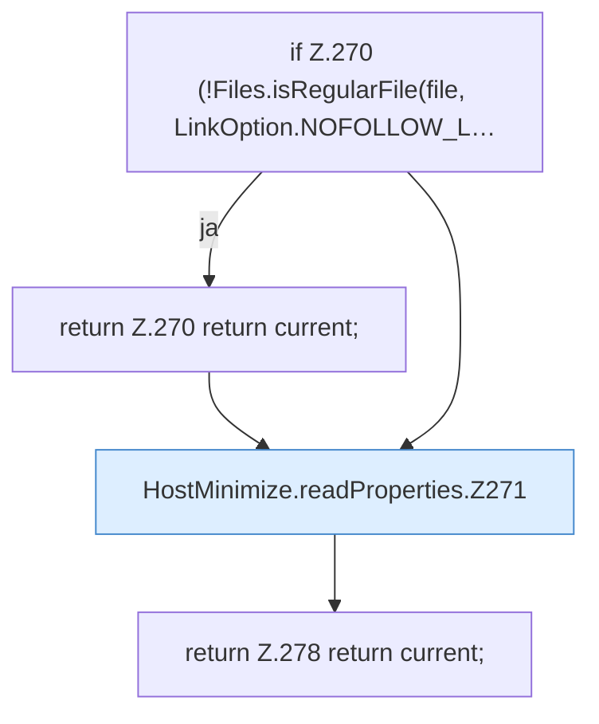

[[00 Start]] › [[Host-Betrieb]] › [[Host-Minimieren]] › [[HostMinimize]] › [[HostMinimize.Teil3]] › [[HostMinimize.readProperties]]

# HostMinimize.readProperties

`HostMinimize.readProperties(Path file)` [src/main/java/de/aichele/childlauncher/HostMinimize.java:268–279](https://github.com/Sciddie/minecraft-serverhoster-plugin/blob/95b02b953b0b4c23673e900e021a7c3c844aa37d/src/main/java/de/aichele/childlauncher/HostMinimize.java#L268-L279)



```knoten
if Z.270 (!Files.isRegularFile(file, LinkOption.NOFOLLOW_L…
  Zeile 270: prüft `(!Files.isRegularFile(file, LinkOption.NOFOLLOW_L…`.
return Z.270 return current;
  Zeile 270: Rückgabe `return current;`.
HostMinimize.readProperties.Z271
  Fortsetzung des Ablaufs ab Zeile 271.
return Z.278 return current;
  Zeile 278: Rückgabe `return current;`.
```

- `readProperties` in `src/main/java/de/aichele/childlauncher/HostMinimize.java`
