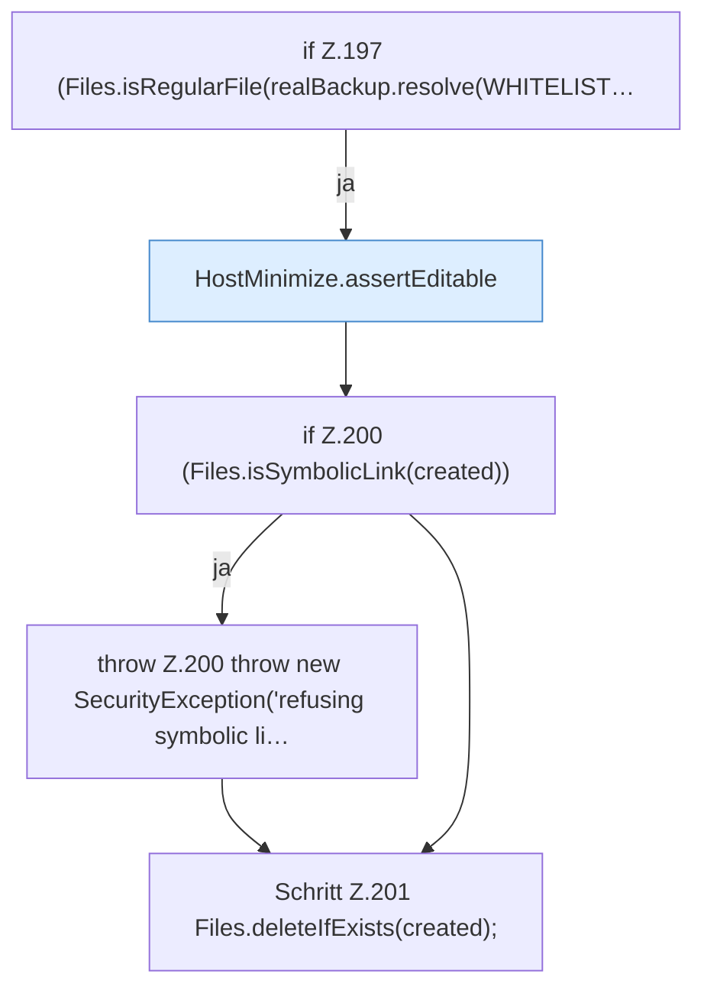

[[00 Start]] › [[Host-Betrieb]] › [[Host-Minimieren]] › [[HostMinimize]] › [[HostMinimize.Teil2]] › [[HostMinimize.restore]] › [[HostMinimize.restore.Z197]]

# HostMinimize.restore.Z197

- Fortsetzung von `HostMinimize.restore`, Quellreihenfolge.
