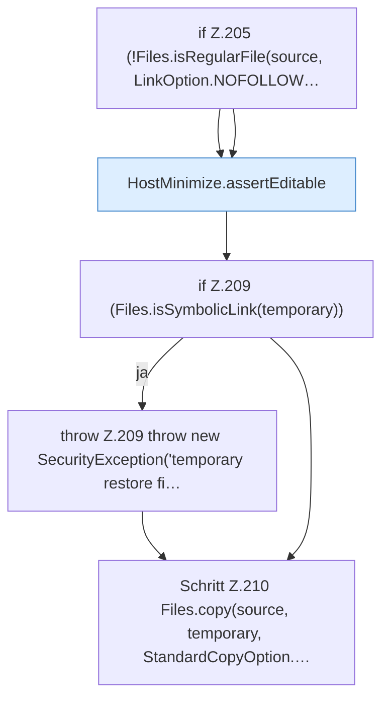

[[00 Start]] › [[Host-Betrieb]] › [[Host-Minimieren]] › [[HostMinimize]] › [[HostMinimize.Teil2]] › [[HostMinimize.restore]] › [[HostMinimize.restore.Z203.Teil1]]

# HostMinimize.restore.Z203.Teil1

- Fortsetzung von `HostMinimize.restore.Z203`, Quellreihenfolge.
