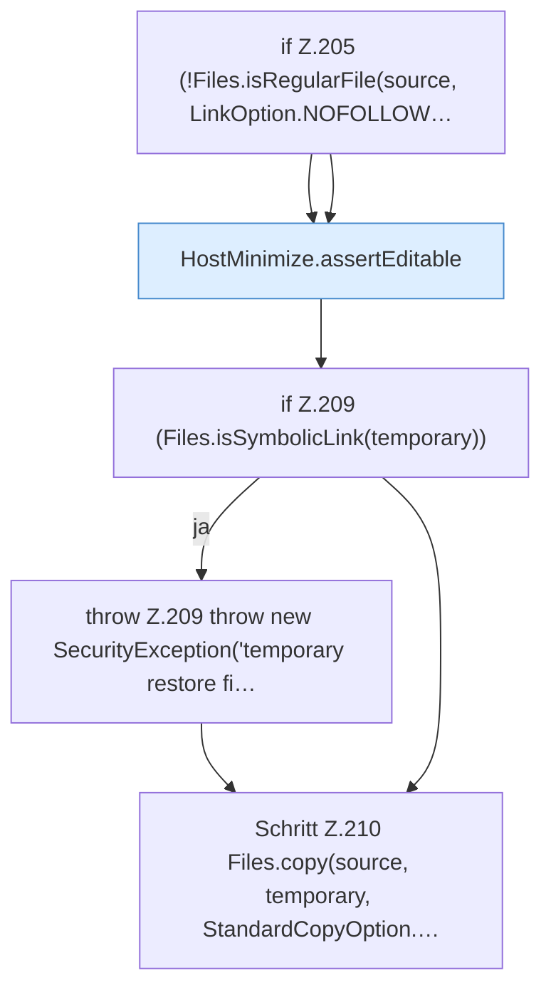

[[00 Start]] › [[Host-Betrieb]] › [[Host-Minimieren]] › [[HostMinimize]] › [[HostMinimize.Teil2]] › [[HostMinimize.restore]] › [[HostMinimize.restore.Z203.Teil1]]

# HostMinimize.restore.Z203.Teil1



```knoten
if Z.205 (!Files.isRegularFile(source, LinkOption.NOFOLLOW…
  Zeile 205: prüft `(!Files.isRegularFile(source, LinkOption.NOFOLLOW…`.
HostMinimize.assertEditable
  Das Verkleinern des [[Glossar#Host|Host]] macht hier einen einzelnen Schritt. Eine Ebene tiefer steht er genauer. Prüft `assertEditable`.
if Z.209 (Files.isSymbolicLink(temporary))
  Zeile 209: prüft `(Files.isSymbolicLink(temporary))`.
throw Z.209 throw new SecurityException('temporary restore fi…
  Zeile 209: Abbruch `throw new SecurityException('temporary restore fi…`.
Schritt Z.210 Files.copy(source, temporary, StandardCopyOption.…
  Zeile 210: Dateioperation. `Files.copy(source, temporary, StandardCopyOption.…`
```

> [!knoten]- Was die Blöcke tun
> - **if Z.205 (!Files.isRegularFile(source, LinkOption.NOFOLLOW…**: Zeile 205: prüft `(!Files.isRegularFile(source, LinkOption.NOFOLLOW…`.
> - **HostMinimize.assertEditable**: Das Verkleinern des [[Glossar#Host|Host]] macht hier einen einzelnen Schritt. Eine Ebene tiefer steht er genauer. Prüft `assertEditable`.
> - **if Z.209 (Files.isSymbolicLink(temporary))**: Zeile 209: prüft `(Files.isSymbolicLink(temporary))`.
> - **throw Z.209 throw new SecurityException('temporary restore fi…**: Zeile 209: Abbruch `throw new SecurityException('temporary restore fi…`.
> - **Schritt Z.210 Files.copy(source, temporary, StandardCopyOption.…**: Zeile 210: Dateioperation. `Files.copy(source, temporary, StandardCopyOption.…`

- Ein weiterer Abschnitt derselben Übersicht.
- Fortsetzung von `HostMinimize.restore.Z203`.
