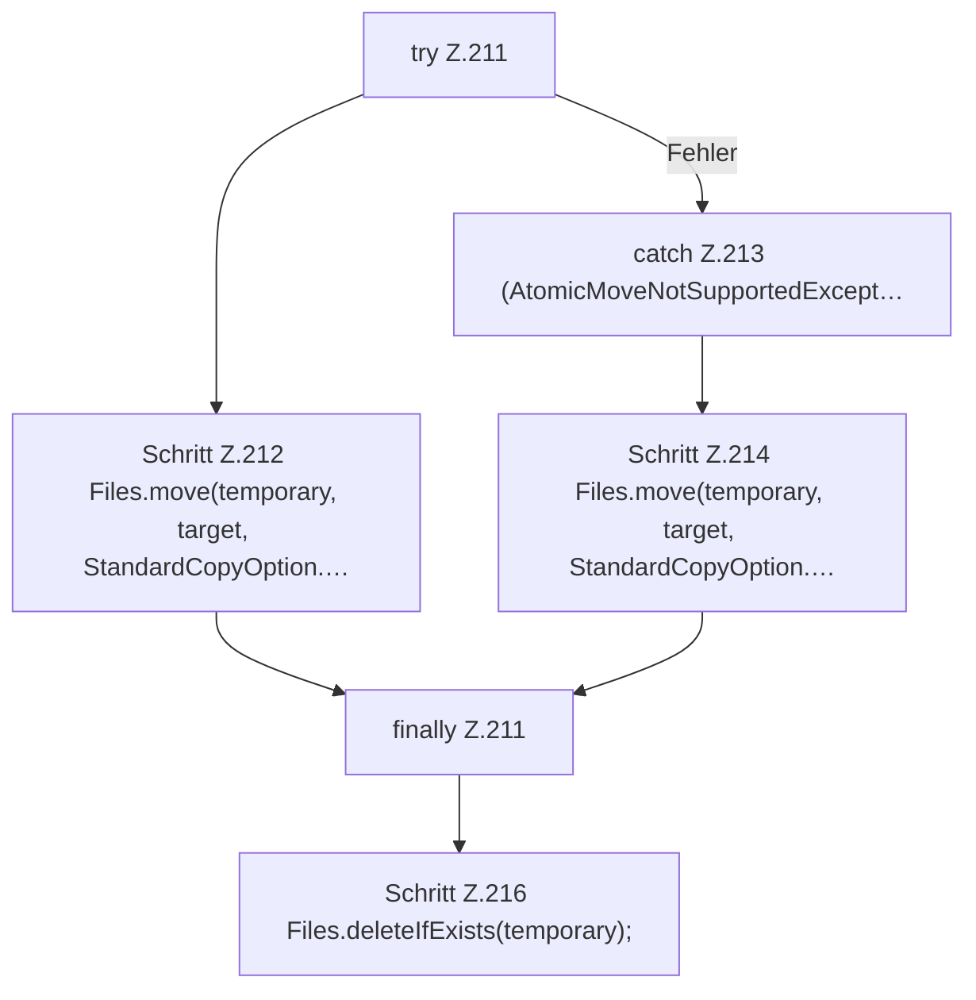

[[00 Start]] › [[Host-Betrieb]] › [[Host-Minimieren]] › [[HostMinimize]] › [[HostMinimize.Teil2]] › [[HostMinimize.restore]] › [[HostMinimize.restore.Z203.Teil2]]

# HostMinimize.restore.Z203.Teil2



```knoten
try Z.211
  Zeile 211: Versuch. Der Fehlerpfad geht in catch.
Schritt Z.212 Files.move(temporary, target, StandardCopyOption.…
  Zeile 212: Dateioperation. `Files.move(temporary, target, StandardCopyOption.…`
catch Z.213 (AtomicMoveNotSupportedExcept…
  Zeile 213: fängt (AtomicMoveNotSupportedExcept….
Schritt Z.214 Files.move(temporary, target, StandardCopyOption.…
  Zeile 214: Dateioperation. `Files.move(temporary, target, StandardCopyOption.…`
finally Z.211
  Läuft danach immer, auch nach einem Fehler.
Schritt Z.216 Files.deleteIfExists(temporary);
  Zeile 216: Dateioperation. `Files.deleteIfExists(temporary);`
```

- Fortsetzung von `HostMinimize.restore.Z203`, Quellreihenfolge.
