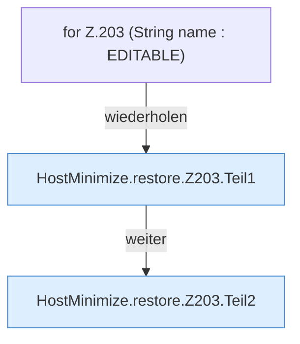

[[00 Start]] › [[Host-Betrieb]] › [[Host-Minimieren]] › [[HostMinimize]] › [[HostMinimize.Teil2]] › [[HostMinimize.restore]] › [[HostMinimize.restore.Z203]]

# HostMinimize.restore.Z203



```knoten
for Z.203 (String name : EDITABLE)
  Zeile 203: Schleife `(String name : EDITABLE)`.
HostMinimize.restore.Z203.Teil1
  Abschnitt 1 dieses Ablaufs, in Quellreihenfolge.
HostMinimize.restore.Z203.Teil2
  Abschnitt 2 dieses Ablaufs, in Quellreihenfolge.
```

- Fortsetzung von `HostMinimize.restore`, Quellreihenfolge.
