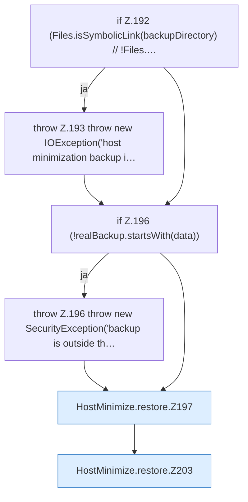

[[00 Start]] › [[Host-Betrieb]] › [[Host-Minimieren]] › [[HostMinimize]] › [[HostMinimize.Teil2]] › [[HostMinimize.restore]]

# HostMinimize.restore

`HostMinimize.restore(Path root, Path backupDirectory, List<Path> protectedPaths)` [src/main/java/de/aichele/childlauncher/HostMinimize.java:191–219](https://github.com/Sciddie/minecraft-serverhoster-plugin/blob/95b02b953b0b4c23673e900e021a7c3c844aa37d/src/main/java/de/aichele/childlauncher/HostMinimize.java#L191-L219)

- `restore` in `src/main/java/de/aichele/childlauncher/HostMinimize.java`
