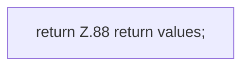

[[00 Start]] › [[Host-Betrieb]] › [[Host-Minimieren]] › [[HostMinimize]] › [[HostMinimize.Teil1]] › [[HostMinimize.spigotChanges]]

# HostMinimize.spigotChanges

`HostMinimize.spigotChanges()` [src/main/java/de/aichele/childlauncher/HostMinimize.java:83–89](https://github.com/Sciddie/minecraft-serverhoster-plugin/blob/95b02b953b0b4c23673e900e021a7c3c844aa37d/src/main/java/de/aichele/childlauncher/HostMinimize.java#L83-L89)



```knoten
return Z.88 return values;
  Zeile 88: Rückgabe `return values;`.
```

- `spigotChanges` in `src/main/java/de/aichele/childlauncher/HostMinimize.java`
