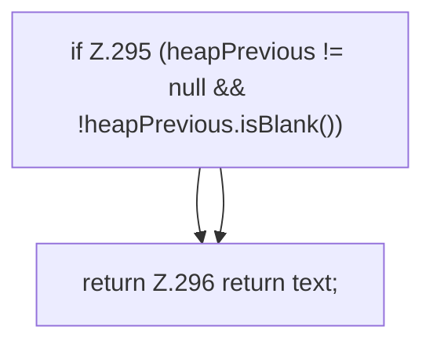

[[00 Start]] › [[Host-Betrieb]] › [[Host-Minimieren]] › [[HostMinimize]] › [[HostMinimize.Teil3]] › [[HostMinimize.stateText]]

# HostMinimize.stateText

`HostMinimize.stateText(String status, String lobbyName, String backup, boolean restartRequired, String heapPrevious)` [src/main/java/de/aichele/childlauncher/HostMinimize.java:292–297](https://github.com/Sciddie/minecraft-serverhoster-plugin/blob/95b02b953b0b4c23673e900e021a7c3c844aa37d/src/main/java/de/aichele/childlauncher/HostMinimize.java#L292-L297)



```knoten
if Z.295 (heapPrevious != null && !heapPrevious.isBlank())
  Zeile 295: prüft `(heapPrevious != null && !heapPrevious.isBlank())`.
return Z.296 return text;
  Zeile 296: Rückgabe `return text;`.
```

> [!knoten]- Was die Blöcke tun
> - **if Z.295 (heapPrevious != null && !heapPrevious.isBlank())**: Zeile 295: prüft `(heapPrevious != null && !heapPrevious.isBlank())`.
> - **return Z.296 return text;**: Zeile 296: Rückgabe `return text;`.

- Das Verkleinern des [[Glossar#Host|Host]] kümmert sich um den Text.
- `stateText` in `src/main/java/de/aichele/childlauncher/HostMinimize.java`
