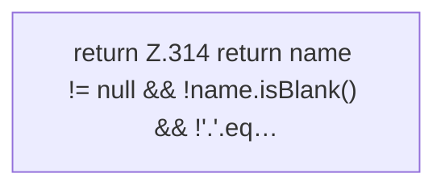

[[00 Start]] › [[Host-Betrieb]] › [[Host-Minimieren]] › [[HostMinimize]] › [[HostMinimize.Teil4]] › [[HostMinimize.worldNameSafe]]

# HostMinimize.worldNameSafe

`HostMinimize.worldNameSafe(String name)` [src/main/java/de/aichele/childlauncher/HostMinimize.java:313–316](https://github.com/Sciddie/minecraft-serverhoster-plugin/blob/95b02b953b0b4c23673e900e021a7c3c844aa37d/src/main/java/de/aichele/childlauncher/HostMinimize.java#L313-L316)



```knoten
return Z.314 return name != null && !name.isBlank() && !'.'.eq…
  Zeile 314: Rückgabe `return name != null && !name.isBlank() && !'.'.eq…`.
```

> [!knoten]- Was die Blöcke tun
> - **return Z.314 return name != null && !name.isBlank() && !'.'.eq…**: Zeile 314: Rückgabe `return name != null && !name.isBlank() && !'.'.eq…`.

- Das Verkleinern des [[Glossar#Host|Host]] kümmert sich um den Namen die erlaubte Grenze.
- `worldNameSafe` in `src/main/java/de/aichele/childlauncher/HostMinimize.java`
