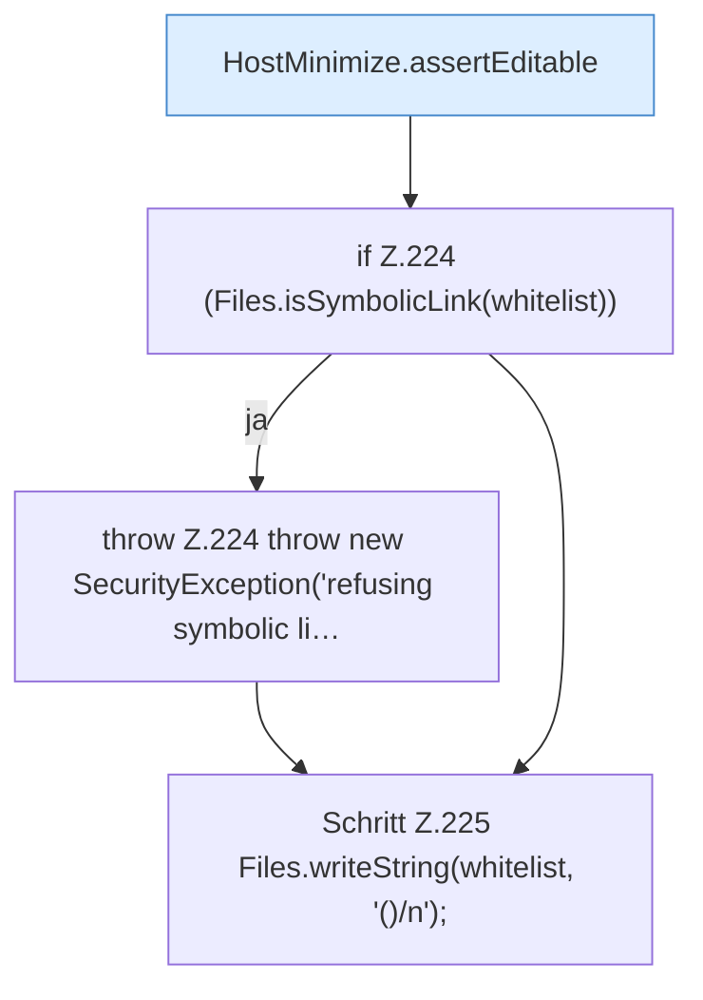

[[00 Start]] › [[Host-Betrieb]] › [[Host-Minimieren]] › [[HostMinimize]] › [[HostMinimize.Teil2]] › [[HostMinimize.writeEmptyWhitelist]]

# HostMinimize.writeEmptyWhitelist

`HostMinimize.writeEmptyWhitelist(Path root, List<Path> protectedPaths)` [src/main/java/de/aichele/childlauncher/HostMinimize.java:221–226](https://github.com/Sciddie/minecraft-serverhoster-plugin/blob/95b02b953b0b4c23673e900e021a7c3c844aa37d/src/main/java/de/aichele/childlauncher/HostMinimize.java#L221-L226)

- `writeEmptyWhitelist` in `src/main/java/de/aichele/childlauncher/HostMinimize.java`
