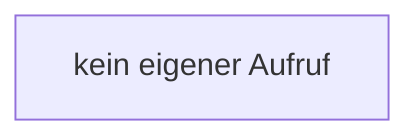

[[00 Start]] › [[Tests]] › [[HostMinimizeTest]] › [[HostMinimizeTest.Teil2]] › [[HostMinimizeTest.RecordingWorld.spawnFlags]]

# HostMinimizeTest.RecordingWorld.spawnFlags

`HostMinimizeTest.RecordingWorld.spawnFlags(boolean monsters, boolean animals)` [src/test/java/de/aichele/childlauncher/HostMinimizeTest.java:337–337](https://github.com/Sciddie/minecraft-serverhoster-plugin/blob/95b02b953b0b4c23673e900e021a7c3c844aa37d/src/test/java/de/aichele/childlauncher/HostMinimizeTest.java#L337-L337)



```knoten
kein eigener Aufruf
  In diesem Stück gibt es keinen weiteren eigenen Aufruf.
```

- `spawnFlags` in `src/test/java/de/aichele/childlauncher/HostMinimizeTest.java`
- Auslöser: Test
