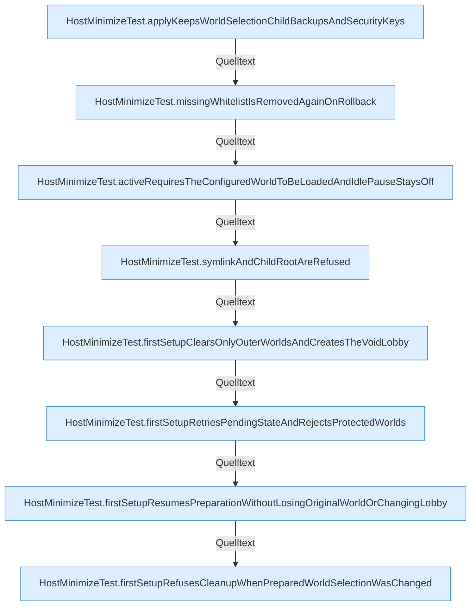

[[00 Start]] › [[Tests]] › [[HostMinimizeTest]] › [[HostMinimizeTest.Teil1]]

# HostMinimizeTest.Teil1



```knoten
HostMinimizeTest.applyKeepsWorldSelectionChildBackupsAndSecurityKeys
  Wendet an `applyKeepsWorldSelectionChildBackupsAndSecurityKeys`. Ruft `apply`, `restore`. Nur Test.
HostMinimizeTest.missingWhitelistIsRemovedAgainOnRollback
  `missingWhitelistIsRemovedAgainOnRollback` in `HostMinimizeTest.java`. Ruft `apply`, `restore`. Nur Test.
HostMinimizeTest.activeRequiresTheConfiguredWorldToBeLoadedAndIdlePauseStaysOff
  `activeRequiresTheConfiguredWorldToBeLoadedAndIdlePauseStaysOff` in `HostMinimizeTest.java`. Ruft `phase`, `playersBlocked`, `clearIdlePause`. Nur Test.
HostMinimizeTest.symlinkAndChildRootAreRefused
  `symlinkAndChildRootAreRefused` in `HostMinimizeTest.java`. Ruft `apply`. Nur Test.
HostMinimizeTest.firstSetupClearsOnlyOuterWorldsAndCreatesTheVoidLobby
  `firstSetupClearsOnlyOuterWorldsAndCreatesTheVoidLobby` in `HostMinimizeTest.java`. Ruft `shouldRun`, `apply`, `readState`. Nur Test.
HostMinimizeTest.firstSetupRetriesPendingStateAndRejectsProtectedWorlds
  `firstSetupRetriesPendingStateAndRejectsProtectedWorlds` in `HostMinimizeTest.java`. Ruft `shouldRun`, `apply`, `readState`. Nur Test.
HostMinimizeTest.firstSetupResumesPreparationWithoutLosingOriginalWorldOrChangingLobby
  `firstSetupResumesPreparationWithoutLosingOriginalWorldOrChangingLobby` in `HostMinimizeTest.java`. Ruft `shouldRun`, `apply`, `completeRestart`. Nur Test.
HostMinimizeTest.firstSetupRefusesCleanupWhenPreparedWorldSelectionWasChanged
  `firstSetupRefusesCleanupWhenPreparedWorldSelectionWasChanged` in `HostMinimizeTest.java`. Ruft `shouldRun`, `apply`, `completeRestart`. Nur Test.
```


