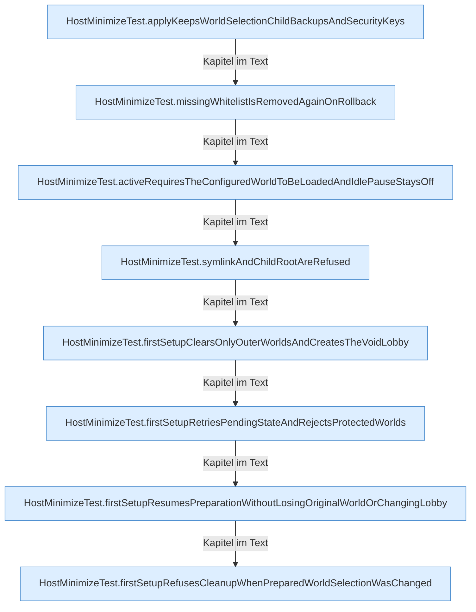

[[00 Start]] › [[Tests]] › [[HostMinimizeTest]] › [[HostMinimizeTest.Teil1]]

# HostMinimizeTest.Teil1



```knoten
HostMinimizeTest.applyKeepsWorldSelectionChildBackupsAndSecurityKeys
  Ein Schritt in einem [[Glossar#Probelauf|Probelauf]]. Er gehört nicht zum laufenden Server. Im [[Glossar#Quelltext|Quelltext]] heißt das `applyKeepsWorldSelectionChildBackupsAndSecurityKeys`.
HostMinimizeTest.missingWhitelistIsRemovedAgainOnRollback
  Ein Schritt in einem [[Glossar#Probelauf|Probelauf]]. Er gehört nicht zum laufenden Server. Im [[Glossar#Quelltext|Quelltext]] heißt das `missingWhitelistIsRemovedAgainOnRollback`.
HostMinimizeTest.activeRequiresTheConfiguredWorldToBeLoadedAndIdlePauseStaysOff
  Ein Schritt in einem [[Glossar#Probelauf|Probelauf]]. Er gehört nicht zum laufenden Server. Im [[Glossar#Quelltext|Quelltext]] heißt das `activeRequiresTheConfiguredWorldToBeLoadedAndIdlePauseStaysOff`.
HostMinimizeTest.symlinkAndChildRootAreRefused
  Ein Schritt in einem [[Glossar#Probelauf|Probelauf]]. Er gehört nicht zum laufenden Server. Im [[Glossar#Quelltext|Quelltext]] heißt das `symlinkAndChildRootAreRefused`.
HostMinimizeTest.firstSetupClearsOnlyOuterWorldsAndCreatesTheVoidLobby
  Ein Schritt in einem [[Glossar#Probelauf|Probelauf]]. Er gehört nicht zum laufenden Server. Im [[Glossar#Quelltext|Quelltext]] heißt das `firstSetupClearsOnlyOuterWorldsAndCreatesTheVoidLobby`.
HostMinimizeTest.firstSetupRetriesPendingStateAndRejectsProtectedWorlds
  Ein Schritt in einem [[Glossar#Probelauf|Probelauf]]. Er gehört nicht zum laufenden Server. Im [[Glossar#Quelltext|Quelltext]] heißt das `firstSetupRetriesPendingStateAndRejectsProtectedWorlds`.
HostMinimizeTest.firstSetupResumesPreparationWithoutLosingOriginalWorldOrChangingLobby
  Ein Schritt in einem [[Glossar#Probelauf|Probelauf]]. Er gehört nicht zum laufenden Server. Im [[Glossar#Quelltext|Quelltext]] heißt das `firstSetupResumesPreparationWithoutLosingOriginalWorldOrChangingLobby`.
HostMinimizeTest.firstSetupRefusesCleanupWhenPreparedWorldSelectionWasChanged
  Ein Schritt in einem [[Glossar#Probelauf|Probelauf]]. Er gehört nicht zum laufenden Server. Im [[Glossar#Quelltext|Quelltext]] heißt das `firstSetupRefusesCleanupWhenPreparedWorldSelectionWasChanged`.
```

> [!knoten]- Was die Blöcke tun
> - **HostMinimizeTest.applyKeepsWorldSelectionChildBackupsAndSecurityKeys**: Ein Schritt in einem [[Glossar#Probelauf|Probelauf]]. Er gehört nicht zum laufenden Server. Im [[Glossar#Quelltext|Quelltext]] heißt das `applyKeepsWorldSelectionChildBackupsAndSecurityKeys`.
> - **HostMinimizeTest.missingWhitelistIsRemovedAgainOnRollback**: Ein Schritt in einem [[Glossar#Probelauf|Probelauf]]. Er gehört nicht zum laufenden Server. Im [[Glossar#Quelltext|Quelltext]] heißt das `missingWhitelistIsRemovedAgainOnRollback`.
> - **HostMinimizeTest.activeRequiresTheConfiguredWorldToBeLoadedAndIdlePauseStaysOff**: Ein Schritt in einem [[Glossar#Probelauf|Probelauf]]. Er gehört nicht zum laufenden Server. Im [[Glossar#Quelltext|Quelltext]] heißt das `activeRequiresTheConfiguredWorldToBeLoadedAndIdlePauseStaysOff`.
> - **HostMinimizeTest.symlinkAndChildRootAreRefused**: Ein Schritt in einem [[Glossar#Probelauf|Probelauf]]. Er gehört nicht zum laufenden Server. Im [[Glossar#Quelltext|Quelltext]] heißt das `symlinkAndChildRootAreRefused`.
> - **HostMinimizeTest.firstSetupClearsOnlyOuterWorldsAndCreatesTheVoidLobby**: Ein Schritt in einem [[Glossar#Probelauf|Probelauf]]. Er gehört nicht zum laufenden Server. Im [[Glossar#Quelltext|Quelltext]] heißt das `firstSetupClearsOnlyOuterWorldsAndCreatesTheVoidLobby`.
> - **HostMinimizeTest.firstSetupRetriesPendingStateAndRejectsProtectedWorlds**: Ein Schritt in einem [[Glossar#Probelauf|Probelauf]]. Er gehört nicht zum laufenden Server. Im [[Glossar#Quelltext|Quelltext]] heißt das `firstSetupRetriesPendingStateAndRejectsProtectedWorlds`.
> - **HostMinimizeTest.firstSetupResumesPreparationWithoutLosingOriginalWorldOrChangingLobby**: Ein Schritt in einem [[Glossar#Probelauf|Probelauf]]. Er gehört nicht zum laufenden Server. Im [[Glossar#Quelltext|Quelltext]] heißt das `firstSetupResumesPreparationWithoutLosingOriginalWorldOrChangingLobby`.
> - **HostMinimizeTest.firstSetupRefusesCleanupWhenPreparedWorldSelectionWasChanged**: Ein Schritt in einem [[Glossar#Probelauf|Probelauf]]. Er gehört nicht zum laufenden Server. Im [[Glossar#Quelltext|Quelltext]] heißt das `firstSetupRefusesCleanupWhenPreparedWorldSelectionWasChanged`.

- Ein weiterer Abschnitt derselben Übersicht.
