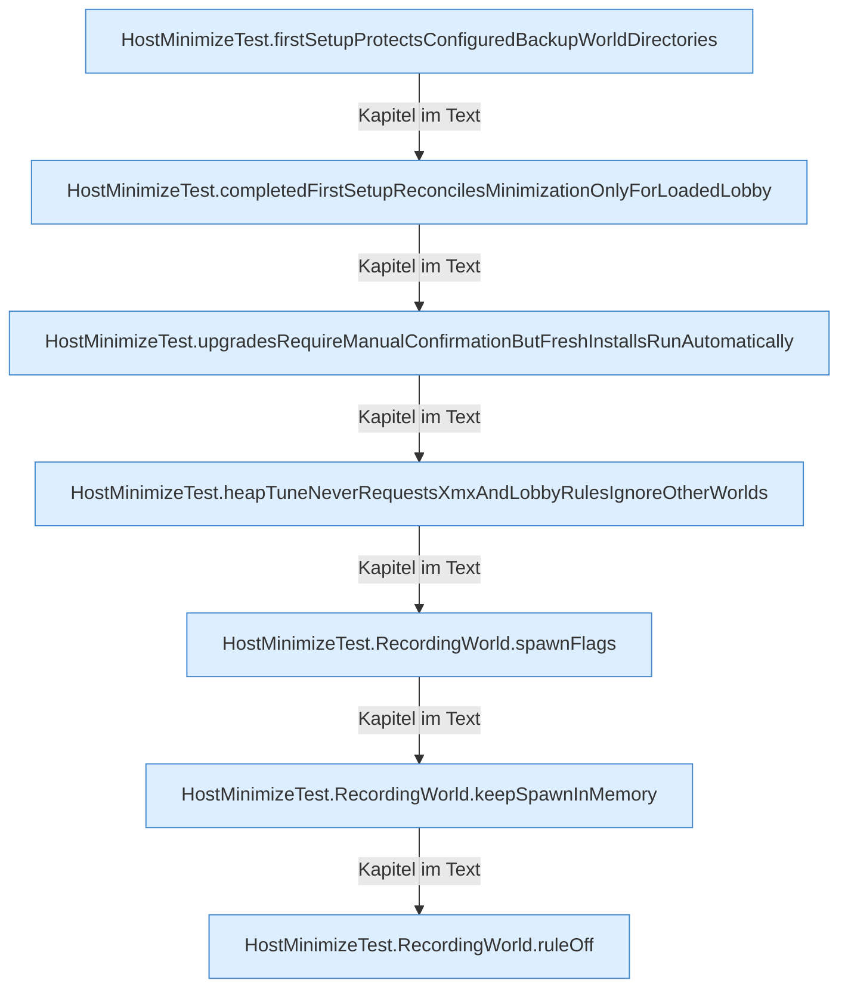

[[00 Start]] › [[Tests]] › [[HostMinimizeTest]] › [[HostMinimizeTest.Teil2]]

# HostMinimizeTest.Teil2



```knoten
HostMinimizeTest.firstSetupProtectsConfiguredBackupWorldDirectories
  Ein Schritt in einem [[Glossar#Probelauf|Probelauf]]. Er gehört nicht zum laufenden Server. Im [[Glossar#Quelltext|Quelltext]] heißt das `firstSetupProtectsConfiguredBackupWorldDirectories`.
HostMinimizeTest.completedFirstSetupReconcilesMinimizationOnlyForLoadedLobby
  Ein Schritt in einem [[Glossar#Probelauf|Probelauf]]. Er gehört nicht zum laufenden Server. Im [[Glossar#Quelltext|Quelltext]] heißt das `completedFirstSetupReconcilesMinimizationOnlyForLoadedLobby`.
HostMinimizeTest.upgradesRequireManualConfirmationButFreshInstallsRunAutomatically
  Ein Schritt in einem [[Glossar#Probelauf|Probelauf]]. Er gehört nicht zum laufenden Server. Im [[Glossar#Quelltext|Quelltext]] heißt das `upgradesRequireManualConfirmationButFreshInstallsRunAutomatically`.
HostMinimizeTest.heapTuneNeverRequestsXmxAndLobbyRulesIgnoreOtherWorlds
  Ein Schritt in einem [[Glossar#Probelauf|Probelauf]]. Er gehört nicht zum laufenden Server. Im [[Glossar#Quelltext|Quelltext]] heißt das `heapTuneNeverRequestsXmxAndLobbyRulesIgnoreOtherWorlds`.
HostMinimizeTest.RecordingWorld.spawnFlags
  Ein Schritt in einem [[Glossar#Probelauf|Probelauf]]. Er gehört nicht zum laufenden Server. Im [[Glossar#Quelltext|Quelltext]] heißt das `spawnFlags`.
HostMinimizeTest.RecordingWorld.keepSpawnInMemory
  Ein Schritt in einem [[Glossar#Probelauf|Probelauf]]. Er gehört nicht zum laufenden Server. Im [[Glossar#Quelltext|Quelltext]] heißt das `keepSpawnInMemory`.
HostMinimizeTest.RecordingWorld.ruleOff
  Ein Schritt in einem [[Glossar#Probelauf|Probelauf]]. Er gehört nicht zum laufenden Server. Im [[Glossar#Quelltext|Quelltext]] heißt das `ruleOff`.
```

> [!knoten]- Was die Blöcke tun
> - **HostMinimizeTest.firstSetupProtectsConfiguredBackupWorldDirectories**: Ein Schritt in einem [[Glossar#Probelauf|Probelauf]]. Er gehört nicht zum laufenden Server. Im [[Glossar#Quelltext|Quelltext]] heißt das `firstSetupProtectsConfiguredBackupWorldDirectories`.
> - **HostMinimizeTest.completedFirstSetupReconcilesMinimizationOnlyForLoadedLobby**: Ein Schritt in einem [[Glossar#Probelauf|Probelauf]]. Er gehört nicht zum laufenden Server. Im [[Glossar#Quelltext|Quelltext]] heißt das `completedFirstSetupReconcilesMinimizationOnlyForLoadedLobby`.
> - **HostMinimizeTest.upgradesRequireManualConfirmationButFreshInstallsRunAutomatically**: Ein Schritt in einem [[Glossar#Probelauf|Probelauf]]. Er gehört nicht zum laufenden Server. Im [[Glossar#Quelltext|Quelltext]] heißt das `upgradesRequireManualConfirmationButFreshInstallsRunAutomatically`.
> - **HostMinimizeTest.heapTuneNeverRequestsXmxAndLobbyRulesIgnoreOtherWorlds**: Ein Schritt in einem [[Glossar#Probelauf|Probelauf]]. Er gehört nicht zum laufenden Server. Im [[Glossar#Quelltext|Quelltext]] heißt das `heapTuneNeverRequestsXmxAndLobbyRulesIgnoreOtherWorlds`.
> - **HostMinimizeTest.RecordingWorld.spawnFlags**: Ein Schritt in einem [[Glossar#Probelauf|Probelauf]]. Er gehört nicht zum laufenden Server. Im [[Glossar#Quelltext|Quelltext]] heißt das `spawnFlags`.
> - **HostMinimizeTest.RecordingWorld.keepSpawnInMemory**: Ein Schritt in einem [[Glossar#Probelauf|Probelauf]]. Er gehört nicht zum laufenden Server. Im [[Glossar#Quelltext|Quelltext]] heißt das `keepSpawnInMemory`.
> - **HostMinimizeTest.RecordingWorld.ruleOff**: Ein Schritt in einem [[Glossar#Probelauf|Probelauf]]. Er gehört nicht zum laufenden Server. Im [[Glossar#Quelltext|Quelltext]] heißt das `ruleOff`.

- Ein weiterer Abschnitt derselben Übersicht.
