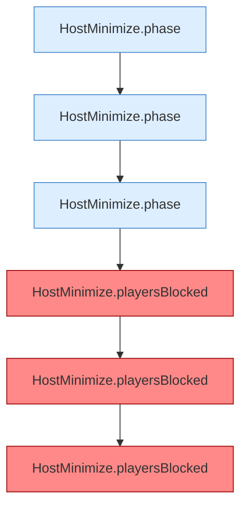

[[00 Start]] › [[Tests]] › [[HostMinimizeTest]] › [[HostMinimizeTest.Teil1]] › [[HostMinimizeTest.activeRequiresTheConfiguredWorldToBeLoadedAndIdlePauseStaysOff]] › [[HostMinimizeTest.activeRequiresTheConfiguredWorldToBeLoadedAndIdlePauseStaysOff.Teil1]]

# HostMinimizeTest.activeRequiresTheConfiguredWorldToBeLoadedAndIdlePauseStaysOff.Teil1



```knoten
HostMinimize.phase
  Liefert die Phase `phase`. Ruft `worldNameSafe`.
HostMinimize.playersBlocked
  Liefert die Spieler `playersBlocked`. Befund: toter Code (wahrscheinlich).
```

- Fortsetzung von `HostMinimizeTest.activeRequiresTheConfiguredWorldToBeLoadedAndIdlePauseStaysOff`, Quellreihenfolge.
