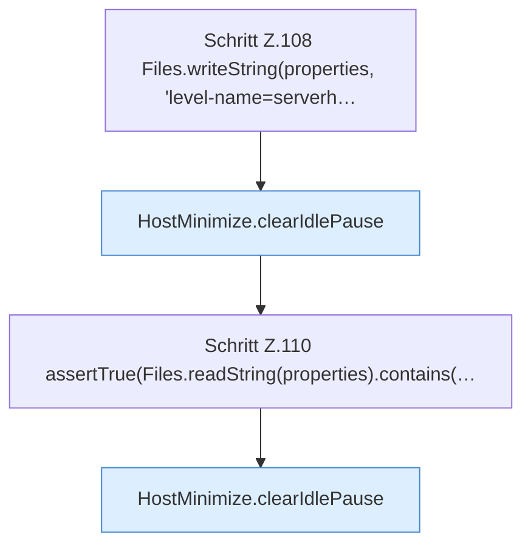

[[00 Start]] › [[Tests]] › [[HostMinimizeTest]] › [[HostMinimizeTest.Teil1]] › [[HostMinimizeTest.activeRequiresTheConfiguredWorldToBeLoadedAndIdlePauseStaysOff]] › [[HostMinimizeTest.activeRequiresTheConfiguredWorldToBeLoadedAndIdlePauseStaysOff.Teil2]]

# HostMinimizeTest.activeRequiresTheConfiguredWorldToBeLoadedAndIdlePauseStaysOff.Teil2

- Fortsetzung von `HostMinimizeTest.activeRequiresTheConfiguredWorldToBeLoadedAndIdlePauseStaysOff`, Quellreihenfolge.
