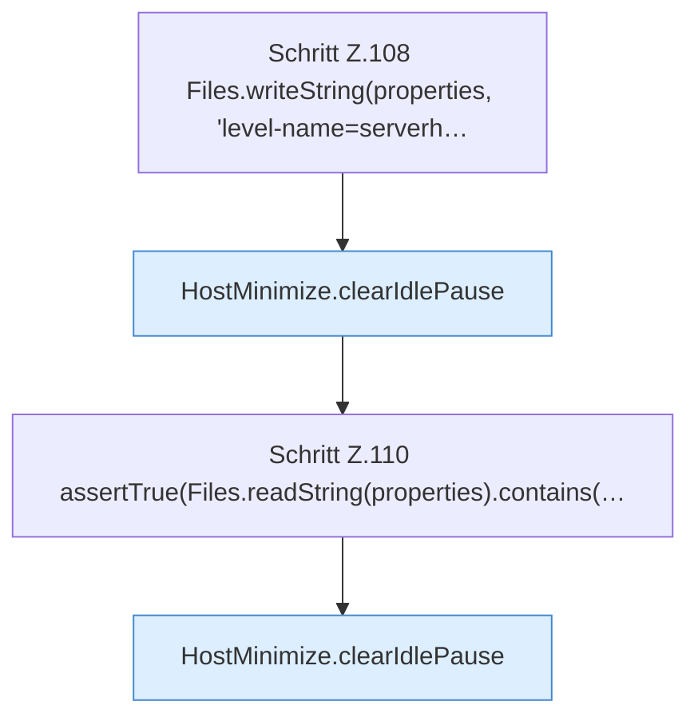

[[00 Start]] › [[Tests]] › [[HostMinimizeTest]] › [[HostMinimizeTest.Teil1]] › [[HostMinimizeTest.activeRequiresTheConfiguredWorldToBeLoadedAndIdlePauseStaysOff]] › [[HostMinimizeTest.activeRequiresTheConfiguredWorldToBeLoadedAndIdlePauseStaysOff.Teil2]]

# HostMinimizeTest.activeRequiresTheConfiguredWorldToBeLoadedAndIdlePauseStaysOff.Teil2



```knoten
Schritt Z.108 Files.writeString(properties, 'level-name=serverh…
  Zeile 108: schreibt Text in eine Datei. `Files.writeString(properties, 'level-name=serverh…`
HostMinimize.clearIdlePause
  Das Verkleinern des [[Glossar#Host|Host]] löscht den gemerkten Stand von hier einen Schritt. Eine Ebene tiefer steht er genauer. Leert `clearIdlePause`. Ruft `lobbyNameSafe`.
Schritt Z.110 assertTrue(Files.readString(properties).contains(…
  Zeile 110: liest Text aus einer Datei. `assertTrue(Files.readString(properties).contains(…`
```

> [!knoten]- Was die Blöcke tun
> - **Schritt Z.108 Files.writeString(properties, 'level-name=serverh…**: Zeile 108: schreibt Text in eine Datei. `Files.writeString(properties, 'level-name=serverh…`
> - **HostMinimize.clearIdlePause**: Das Verkleinern des [[Glossar#Host|Host]] löscht den gemerkten Stand von hier einen Schritt. Eine Ebene tiefer steht er genauer. Leert `clearIdlePause`. Ruft `lobbyNameSafe`.
> - **Schritt Z.110 assertTrue(Files.readString(properties).contains(…**: Zeile 110: liest Text aus einer Datei. `assertTrue(Files.readString(properties).contains(…`

- Ein weiterer Abschnitt derselben Übersicht.
- Fortsetzung von `HostMinimizeTest.activeRequiresTheConfiguredWorldToBeLoadedAndIdlePauseStaysOff`.
