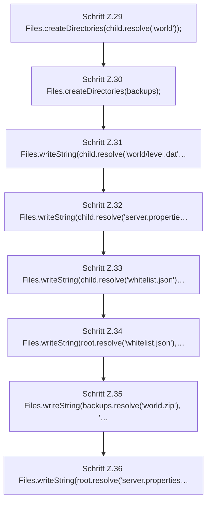

[[00 Start]] › [[Tests]] › [[HostMinimizeTest]] › [[HostMinimizeTest.Teil1]] › [[HostMinimizeTest.applyKeepsWorldSelectionChildBackupsAndSecurityKeys]] › [[HostMinimizeTest.applyKeepsWorldSelectionChildBackupsAndSecurityKeys.Teil1]]

# HostMinimizeTest.applyKeepsWorldSelectionChildBackupsAndSecurityKeys.Teil1

- Fortsetzung von `HostMinimizeTest.applyKeepsWorldSelectionChildBackupsAndSecurityKeys`, Quellreihenfolge.
